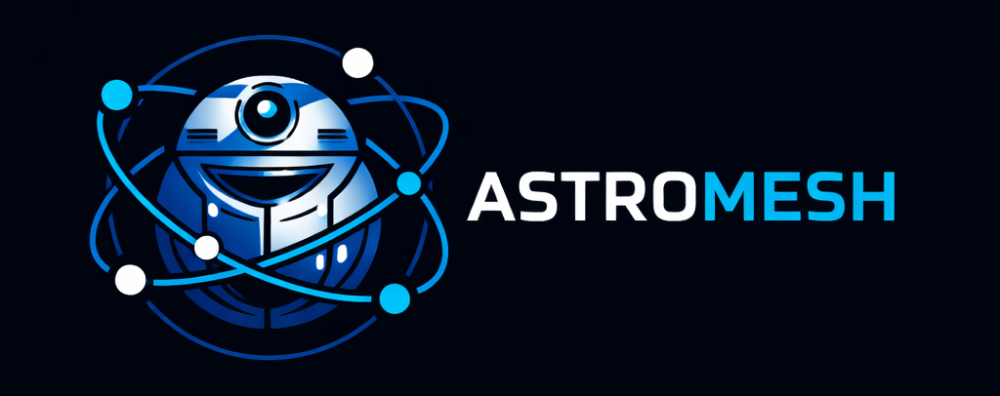
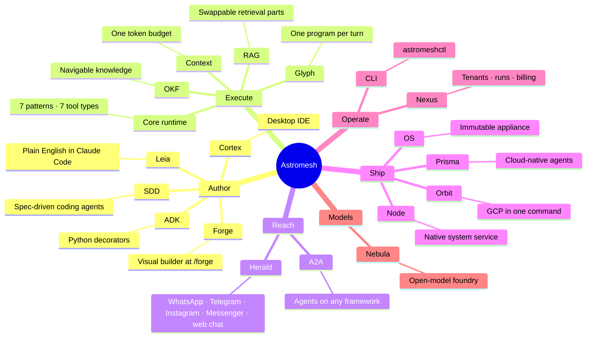
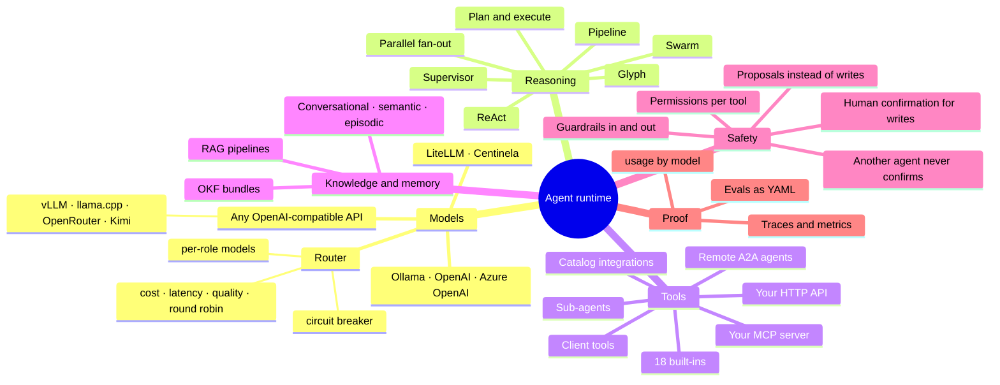
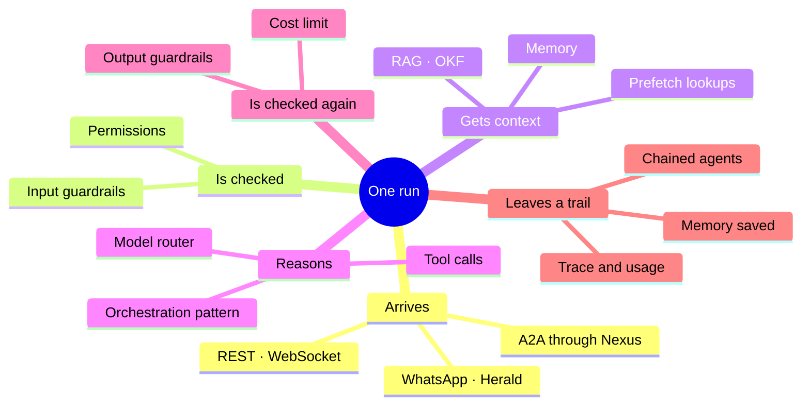

<p align="center">
  
</p>

<h3 align="center">An open-source runtime for AI agents, and everything around it.</h3>

<p align="center">
  Describe an agent in YAML or Python. Astromesh runs it, routes it across models, gives it tools,
  memory and knowledge, guards it, measures it, and puts it in front of people and other agents.
</p>

<p align="center">
  <a href="https://github.com/monaccode/astromesh/actions/workflows/ci.yml"></a>
  <a href="https://pypi.org/project/astromesh/"></a>
  <a href="https://hub.docker.com/r/fulfarodev/astromesh"></a>
  <a href="https://monaccode.github.io/astromesh/"></a>
  <a href="https://github.com/monaccode/astromesh/blob/develop/LICENSE"></a>
  <a href="https://www.python.org/"></a>
</p>

<p align="center">
  <a href="https://monaccode.github.io/astromesh/"><b>Documentation</b></a> ·
  <a href="https://monaccode.github.io/astromesh/getting-started/quickstart/">Quick start</a> ·
  <a href="https://monaccode.github.io/astromesh/#ecosystem">Ecosystem map</a> ·
  <a href="#how-it-compares">How it compares</a> ·
  <a href="https://github.com/monaccode/astromesh/releases">Releases</a>
</p>

---

## The ecosystem at a glance

Astromesh started as a runtime and grew into the pieces an agent needs on its way to production.
Each one stands on its own and moves on its own release clock.



Current versions live in one place, the **[ecosystem map](https://monaccode.github.io/astromesh/#ecosystem)**,
so this page never goes stale the day after a release.

---

## Pick your path

| I want to… | Use | Start with |
|---|---|---|
| Run an agent defined in a YAML file | **Core runtime** | `uv sync && uv run uvicorn astromesh.api.main:app` |
| Write agents in Python | **[ADK](astromesh-adk/)** | `pip install astromesh-adk` |
| Build an agent without writing YAML | **[Forge](astromesh-forge/)** or **[Cortex](https://monaccode.github.io/astromesh/cortex/introduction/)** | Open `http://localhost:8000/forge` |
| Describe an agent in plain language | **[Leia](https://github.com/monaccode/astromesh-leia)** | `/leia I need a WhatsApp bot for my workshop` |
| Answer customers on WhatsApp, Instagram or Messenger | **[Herald](https://monaccode.github.io/astromesh/herald/introduction/)** + **[Nexus](https://monaccode.github.io/astromesh/nexus/introduction/)** | Herald quick start |
| Let my agent call agents on other frameworks, safely | **[astromesh-a2a](https://github.com/monaccode/astromesh-a2a)** or a `type: a2a` tool | `pip install astromesh-a2a` |
| Ground an agent in documents that go stale | **[OKF](https://github.com/monaccode/astromesh-okf)** · **[RAG](https://github.com/monaccode/astromesh-rag)** · **[Context](https://github.com/monaccode/astromesh-context)** | `pip install astromesh-context` |
| Run many tenants' agents and bill them | **[Nexus](https://monaccode.github.io/astromesh/nexus/introduction/)** | `kubectl apply -k deploy/overlays/mvp` |
| Install the runtime as a service | **[Node](astromesh-node/)** or **[OS](https://github.com/monaccode/astromesh-os)** | `sudo apt install ./astromesh-node_<version>_amd64.deb` |
| Deploy the stack to the cloud | **[Orbit](astromesh-orbit/)** | `pip install "astromesh-orbit[gcp]"` |
| Have a coding agent build software from a spec | **[SDD](https://github.com/monaccode/astromesh-sdd)** | `/plugin marketplace add monaccode/astromesh-sdd` |

The open-source libraries (A2A, OKF, RAG, Context, SDD) do not need the runtime. They work from
LangChain, LangGraph, CrewAI, PydanticAI, the OpenAI Agents SDK, Google ADK, LlamaIndex and MCP.

---

## How it compares

Most agent frameworks are libraries for writing the agent's logic. Astromesh covers that and
the operations around it. This table compares scope only: LangGraph, CrewAI and the vendor SDKs
have much larger communities and integration catalogs, and that matters too.

| | Astromesh | LangGraph | CrewAI | MS Agent Framework | OpenAI Agents SDK | Google ADK | PydanticAI |
|---|:---:|:---:|:---:|:---:|:---:|:---:|:---:|
| Agent defined in a config file, no code | ✅ | 💲 | 🟡 | 🟡 | — | 🟡 | 🟡 |
| Routing across providers by cost or latency, with fallback | ✅ | 🟡 | — | 🟡 | 🟡 | 🟡 | 🟡 |
| Several multi-agent patterns built in | ✅ | 🟡 | ✅ | ✅ | 🟡 | ✅ | ✅ |
| Input and output guardrails | ✅ | 🟡 | 🟡 | 🟡 | ✅ | 🟡 | ✅ |
| Human approval before a write runs | ✅ | ✅ | ✅ | ✅ | ✅ | 🟡 | ✅ |
| MCP tools | ✅ | ✅ | ✅ | ✅ | ✅ | ✅ | ✅ |
| A2A, as client and as server | ✅ | 💲 | ✅ | ✅ | — | 🟡 | 🟡 |
| Semantic and episodic memory | ✅ | ✅ | ✅ | 🟡 | 🟡 | 🟡 | 🟡 |
| RAG ingestion and retrieval pipeline | ✅ | 🟡 | ✅ | 🟡 | 🟡 | 💲 | 🟡 |
| Evals | ✅ | 💲 | 🟡 | ✅ | 💲 | ✅ | ✅ |
| Tracing and metrics | ✅ | 💲 | 🟡 | ✅ | ✅ | ✅ | ✅ |
| Visual agent builder | ✅ | 💲 | 💲 | 💲 | 💲 | 🟡 | — |
| Install as a service, appliance or cloud IaC | ✅ | 🟡 | 💲 | 💲 | — | 🟡 | — |
| WhatsApp, Telegram, Instagram, Messenger to reach people | 🟡💲 | — | — | — | — | — | — |
| Multi-tenant hosting with metering and billing | 💲 | ? | — | — | — | — | — |

✅ in the open-source project · 🟡 partial or experimental · 💲 a separate product from the same
vendor · — not included, you build or integrate it · ? not verified

How to read the Astromesh column honestly: config-file agents, routing, patterns, guardrails,
approvals, MCP, memory, RAG, evals and tracing are in this open-source runtime. A2A comes from
the open-source [`astromesh-a2a`](https://github.com/monaccode/astromesh-a2a) and the runtime's
`type: a2a` tools. The visual builder is [Forge](astromesh-forge/); service, appliance and IaC are
[Node](astromesh-node/), [OS](https://github.com/monaccode/astromesh-os) and [Orbit](astromesh-orbit/).
WhatsApp is built into the runtime; the other channels come with
[Herald](https://monaccode.github.io/astromesh/herald/introduction/), and multi-tenant hosting with [Nexus](https://monaccode.github.io/astromesh/nexus/introduction/),
which are separate products whose source is not public.

For the other frameworks, each cell comes from that project's official documentation, checked in
October 2026. A "—" means the docs do not describe it, not that nobody has built it on top.
Experimental features (config-file agents in MS Agent Framework and Google ADK, ADK's tool
approval and A2A) are marked 🟡. Spotted something outdated? Open an issue.

---

## What the runtime does



A few things that are easy to miss:

- **Writes wait for a person.** An integration action listed in `confirm` does not run until a
  human answers "sí" to that exact call. An `api` or `mcp` write with `mode: propose` is never
  executed; it comes back to the caller as a proposal. A turn that arrives from another agent
  (`origen: "agente"`) can never confirm anything.
- **Sub-agents are billed honestly.** Their tokens and cost roll up into the parent run, and the
  parent's `cost_limit` counts them.
- **Evals live next to the agent.** A `*.eval.yaml` file with cases, fixtures and a pass rate runs
  with `astromesh-eval`, so a prompt change can fail a build.

---

## Quick start

You need Python 3.12+ and [uv](https://docs.astral.sh/uv/).

```bash
git clone https://github.com/monaccode/astromesh.git
cd astromesh
uv sync
uv run uvicorn astromesh.api.main:app --reload
```

The API listens on `http://localhost:8000`. Create `config/agents/my-agent.agent.yaml`:

```yaml
apiVersion: astromesh/v1
kind: Agent
metadata:
  name: my-agent
spec:
  identity:
    display_name: "My Agent"
  model:
    primary:
      provider: ollama
      model: "llama3.1:8b"
  prompts:
    system: |
      You are a helpful assistant.
  orchestration:
    pattern: react
```

Run it:

```bash
curl -X POST http://localhost:8000/v1/agents/my-agent/run \
  -H "Content-Type: application/json" \
  -d '{"query":"Hello","session_id":"demo"}'
```

Prefer Python? The same agent with the ADK:

```python
from astromesh_adk import agent, tool

@tool
def search(query: str) -> str:
    return f"results for {query}"

@agent(name="greeter", model="openai/gpt-4o", tools=[search])
class Greeter:
    system = "You are a helpful assistant."

result = Greeter().run("Hello, what can you search for?")
print(result.answer)
```

Want the whole stack (runtime, Ollama, Postgres with pgvector, Redis, Prometheus, Grafana)?

```bash
cd docker && docker compose up -d
```

---

## How a run flows



The layers underneath are the API, the runtime engine that loads agents from YAML, the core
services (model router, memory, tools, prompts, guardrails) and the infrastructure (providers,
vector stores, channels, MCP). The full reference is in
[`docs/GENERAL_ARCHITECTURE.md`](docs/GENERAL_ARCHITECTURE.md).

---

## Ecosystem

| Stage | Component | What it does | Where |
|---|---|---|---|
| **Author** | ADK | Agents as Python decorators, with hot reload and a project CLI | [`astromesh-adk/`](astromesh-adk/) |
| | Forge | Visual agent builder, served by the node itself at `/forge` | [`astromesh-forge/`](astromesh-forge/) |
| | Cortex | Desktop IDE that reaches every runtime you own: local, cloud or a Nexus hub | [docs](https://monaccode.github.io/astromesh/cortex/introduction/) |
| | Leia | Agent design and operations in plain language, inside Claude Code | [repo](https://github.com/monaccode/astromesh-leia) |
| | SDD | Spec-driven development for any coding agent: spec, plan, tasks, code, verification | [repo](https://github.com/monaccode/astromesh-sdd) |
| **Execute** | Core runtime | The agent engine this repository is named after | [`astromesh/`](astromesh/) |
| | Glyph | An action language: the model writes one program instead of one tool call per turn | [`astromesh-glyph/`](astromesh-glyph/) |
| | OKF | Agents navigate an Open Knowledge Format bundle, with trust and freshness signals | [repo](https://github.com/monaccode/astromesh-okf) |
| | RAG | Retrieval from swappable parts: naive, hybrid, multi-query or HyDE, with a trace per query | [repo](https://github.com/monaccode/astromesh-rag) |
| | Context | Decides what goes into the window within one token budget, and measures the choice | [repo](https://github.com/monaccode/astromesh-context) |
| **Reach** | Herald | Messages from people reach an agent, and agents reach people back through one outbox | [docs](https://monaccode.github.io/astromesh/herald/introduction/) |
| | A2A | Call, and be called by, agents on any framework over A2A 1.0, without trusting them | [repo](https://github.com/monaccode/astromesh-a2a) |
| **Ship** | Node | The runtime as a native service on Linux, macOS and Windows | [`astromesh-node/`](astromesh-node/) |
| | OS | Immutable, API-only Linux appliance with A/B slots | [repo](https://github.com/monaccode/astromesh-os) |
| | Orbit | One config file becomes a production GCP stack, and ejects to plain Terraform | [`astromesh-orbit/`](astromesh-orbit/) |
| | Prisma | Turns an agent into a cloud's own native agent, and writes down what does not carry over | [docs](https://monaccode.github.io/astromesh/prisma/introduction/) |
| **Operate** | Nexus | Multi-tenant control plane: publishes agents, runs them on a shared pool, meters and bills them, serves them over A2A | [docs](https://monaccode.github.io/astromesh/nexus/introduction/) |
| | CLI | `astromeshctl`, the terminal interface to a node | [`astromesh-cli/`](astromesh-cli/) |
| **Models** | Nebula | The open-model foundry that trains, gates and publishes what the runtime routes to | [repo](https://github.com/monaccode/astromesh-nebula) |

Directories link to this monorepo, where each package is released on its own tag. Cortex, Herald,
Prisma and Nexus link to their documentation: their source is not public. Glyph is
tagged but not on PyPI yet; [`docs/DEBT.md`](docs/DEBT.md) says why.

---

## Repository layout

```
astromesh/              core runtime: api, runtime, core, providers, orchestration,
                        integrations, channels, rag, knowledge, mcp, evals
astromesh-adk/          Agent Development Kit
astromesh-forge/        visual builder (React), served by the node at /forge
astromesh-glyph/        the Glyph action language
astromesh-node/         astromeshd daemon and OS packaging
astromesh-cli/          astromeshctl
astromesh-orbit/        cloud deployment (Terraform, GCP first)
vscode-extension/       agent YAML schema, IntelliSense, traces panel
config/                 agents, RAG pipelines, providers, runtime
docs-site/              the documentation site
docker/                 local stack
```

The runtime can optionally build Rust extensions for chunking, PII redaction, token counting and
routing (`maturin develop --release`); without them it falls back to Python. See
[`docs/NATIVE_ESTENSIONS_RUST.md`](docs/NATIVE_ESTENSIONS_RUST.md).

---

## Roadmap

Done:

- [x] Multi-model runtime with per-role routing and circuit breaker
- [x] Seven orchestration patterns, including Glyph
- [x] Seven tool types: built-in, agent, client, integration, API, MCP and A2A
- [x] Guardrails, permissions, human confirmation and proposals for writes
- [x] Memory (conversational, semantic, episodic), RAG pipelines and OKF knowledge bundles
- [x] Evals as YAML, traces, metrics and usage by model
- [x] ADK, Forge, Cortex, Leia and the VS Code extension
- [x] Multi-tenant hosting, metering and billing with Nexus
- [x] People on WhatsApp, Telegram, Instagram, Messenger and web chat through Herald
- [x] Agent-to-agent over A2A 1.0, as a client and as a server
- [x] Node, OS appliance and Orbit for GCP

Next:

- [ ] Answer-quality results for the context engine (level 2 eval)
- [ ] Glyph on PyPI
- [ ] More clouds for Orbit and Prisma
- [ ] GPU-aware model scheduling

---

## Documentation

Everything is on **[monaccode.github.io/astromesh](https://monaccode.github.io/astromesh/)**:
getting started, configuration, every component, deployment and API reference. A few references
also live in this repository: [`docs/TECH_OVERVIEW.md`](docs/TECH_OVERVIEW.md),
[`docs/GENERAL_ARCHITECTURE.md`](docs/GENERAL_ARCHITECTURE.md),
[`docs/CONFIGURATION_GUIDE.md`](docs/CONFIGURATION_GUIDE.md),
[`docs/DEV_QUICKSTART.md`](docs/DEV_QUICKSTART.md) and [`docs/DEBT.md`](docs/DEBT.md).

## Contributing

Contributions are welcome: providers, orchestration patterns, vector stores, tools, fixes and
docs. Read [`CLAUDE.md`](CLAUDE.md) for how the repository is built and tested, and keep
`CHANGELOG.md` up to date with every `feat` or `fix`.

## License

Apache-2.0. See [`LICENSE`](LICENSE).

<p align="center"><sub>If Astromesh saves you from rebuilding the same plumbing again, a star helps other people find it.</sub></p>
