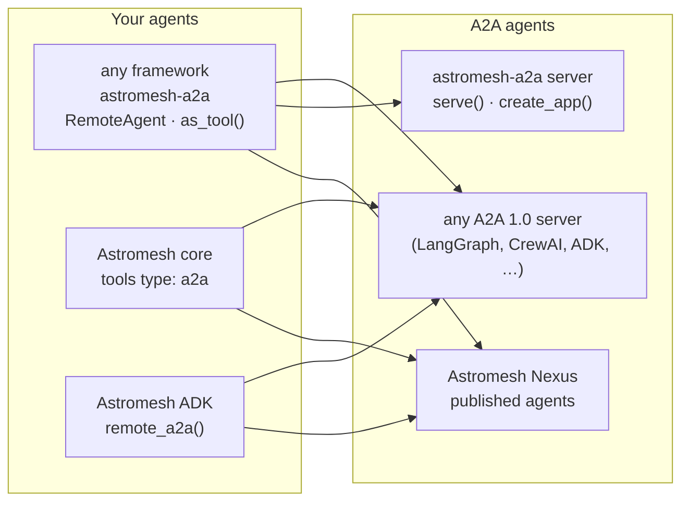

import { Aside } from '@astrojs/starlight/components';
import A2AShowcase from '../../../components/A2AShowcase.astro';

[A2A (Agent2Agent)](https://a2a-protocol.org) is the open protocol agents use to work with each
other. An agent publishes an **Agent Card** — a JSON document that says who it is, what it can do
(its *skills*), where to reach it and which credentials it takes — and other agents send it
**tasks** over JSON-RPC: they get answers, stream progress, poll or cancel a task, and answer the
questions the remote asks along the way.

Astromesh speaks **A2A 1.0** at every layer where an agent meets another one:

```bash
pip install astromesh-a2a              # the open library, in any Python project
pip install "astromesh[a2a]"           # the core: tools of type a2a
pip install "astromesh-adk[a2a]"       # the ADK: remote_a2a()
```

<A2AShowcase />

## Why A2A

Until now an Astromesh agent could call another agent in two ways: in process (`type: agent`) or
through the ADK's own remote protocol against a node. Both stop at the edge of Astromesh. Two
problems came with that:

- **No standard way in or out.** An agent built with LangChain, CrewAI or Google ADK could not call
  an Astromesh agent, and an Astromesh agent could not call theirs. A2A is the protocol those
  frameworks already converge on.
- **A remote run looked like a person.** A run started by another agent reached the node exactly
  like one typed by a person, so a remote model could answer a confirmation gate meant for a human.

A2A solves the first. The second is solved by Astromesh itself, with the turn's **origin**
(below), and every A2A path is built on it.

The other reason is trust. A remote agent is an untrusted program on someone else's server: the
SDK speaks the protocol, but it does not decide which remotes you may reach, how much of their
output you accept, or what your model does with it. That layer is what
[`astromesh-a2a`](/astromesh/a2a/library/) adds, and every Astromesh component uses it.

## The map



| Component | Side | What it does | Docs |
|---|---|---|---|
| **astromesh-a2a** | client and server | The open library: `RemoteAgent` to call a remote under a `Policy`, `serve`/`create_app` to publish your own agent, tools for nine frameworks (LangChain/LangGraph, CrewAI, Google ADK, OpenAI Agents SDK, PydanticAI, LlamaIndex, smolagents, Microsoft Agent Framework, MCP), an attack eval. No dependency on the Astromesh core. | [The library](/astromesh/a2a/library/) |
| **Core `type: a2a`** | client | A remote A2A agent as a tool in the agent YAML, built on the library. | [Tools and ADK](/astromesh/a2a/astromesh-tools/) |
| **ADK `remote_a2a()`** | client | A remote A2A agent with the shape of an ADK agent: `run()`, `stream()`, `as_tool()`. | [Tools and ADK](/astromesh/a2a/astromesh-tools/#adk-remote_a2a) |
| **Nexus** | server | Every published agent that opts in gets an Agent Card and a JSON-RPC endpoint, behind the tenant's credentials, billed like any run. | [Nexus as an A2A server](/astromesh/nexus/a2a-server/) |

The same rules hold on every client path, because they all go through the library: only the hosts
you named are reachable, through a pinned egress guard; the remote's answer reaches the model
wrapped as untrusted data; a remote's question is returned to you, never answered for you.

## Origin: a remote can never confirm for a person

Some actions must not run without the person's consent: in the agent YAML they are listed under
`tools[].confirm` (the [confirmation gate](/astromesh/configuration/confirmation-gate/)), and the
action does not execute until the person says yes. That only works if the runtime knows **who**
said it.

Since core 0.73.0 every turn carries an **origin**: the field `origen` on
[`POST /v1/agents/{name}/run`](/astromesh/reference/api-endpoints/) and on the WebSocket messages,
`"humano"` (the default) or `"agente"`. A turn with `origen: "agente"` **can never confirm** a
`confirm`-gated action, whatever it says. An invalid value is a `422` (REST) or an `error` event
(WebSocket); it never falls back to human.

Every A2A path sets it:

| Path | Origin it sends |
|---|---|
| `astromesh-a2a` client | `Origin.AGENT` by default in every message; the server side marks **every** incoming message `Origin.AGENT` and untrusted, whatever the sender claims. |
| Core `type: a2a` tool | Always `Origin.AGENT`. |
| ADK `remote_a2a()` | Always `Origin.AGENT`, even for a direct `run()`: the ADK cannot tell whether a person typed the query. |
| ADK `bind()`/`connect()`/`remote()` | `origen: "agente"` to the node (ADK 0.7.0). |
| Nexus A2A server | Every A2A run reaches the runtime with `origen: "agente"`. |

The reason is simple: a remote agent's "yes" is text written by a program you do not control. If
the person needs to confirm, the person talks to the agent directly. A remote that asks for
confirmation (`input_required`) gets its question passed back to your agent, which asks the user;
only the user's answer, sent explicitly with `reply()`, continues the task.

<Aside type="caution" title="The protection is as current as the node">
A node older than core 0.73.0 ignores `origen`, so a gated tool behaves as for any other turn. Do
not publish an agent with `confirm`-gated tools over A2A on a runtime older than 0.73.0. Nexus runs
core 0.73.0 or later in its pool since Nexus 0.27.1.
</Aside>

## Skills: what goes on the card

An agent's Agent Card lists its **skills**. In the agent YAML they are `spec.skills` (core
0.73.0+): `id`, `name` and `description` required, `tags`, `examples`, `inputModes` and
`outputModes` optional. The runtime validates them (an invalid entry is skipped with a warning and
the agent still loads), `GET /v1/agents/{name}` returns them, and Nexus puts them on the card. See
[`spec.skills`](/astromesh/configuration/agent-yaml/#specskills).

```yaml
spec:
  identity:
    description: "Builds quotes for our products"   # the card's description in Nexus
  skills:
    - id: quote
      name: Quote
      description: Builds a price quote for a list of products.
      tags: [sales]
      examples: ["Quote 20 licenses of the Pro plan"]
```

## Versions

Each package ships on its own clock. What you need for each piece:

| Piece | Version |
|---|---|
| `astromesh-a2a` (library) | **0.1.0**, on [PyPI](https://pypi.org/project/astromesh-a2a/). Python 3.10+, A2A 1.x over JSON-RPC (a 0.3-only remote is refused). |
| `origen` on run/WebSocket, `spec.skills` | core **≥ 0.73.0** |
| `type: a2a` tools (extra `astromesh[a2a]`) | core **≥ 0.74.0** |
| `remote_a2a()` (extra `astromesh-adk[a2a]`) | ADK **0.7.0** |
| Nexus as an A2A server (card, send, stream, get, cancel) | Nexus **≥ 0.27** (0.27.1 runs core 0.73.0 in the pool) |
| Background runs (`returnImmediately`), `SubscribeToTask`, `ListTasks`, push notifications | Nexus **≥ 0.28** (0.28.1 runs core 0.74.0, so published agents can call `type: a2a` tools) |

## Next steps

- [The astromesh-a2a library](/astromesh/a2a/library/) — client, policy, server, framework tools and the eval
- [In Astromesh: tools and ADK](/astromesh/a2a/astromesh-tools/) — `type: a2a` in the agent YAML, and `remote_a2a()`
- [Nexus as an A2A server](/astromesh/nexus/a2a-server/) — publish an agent, authenticate, methods, push notifications
- [Repository](https://github.com/monaccode/astromesh-a2a) — source, examples and changelog
