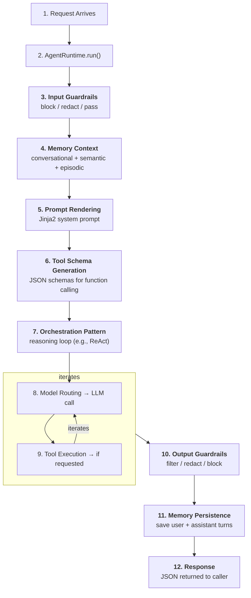
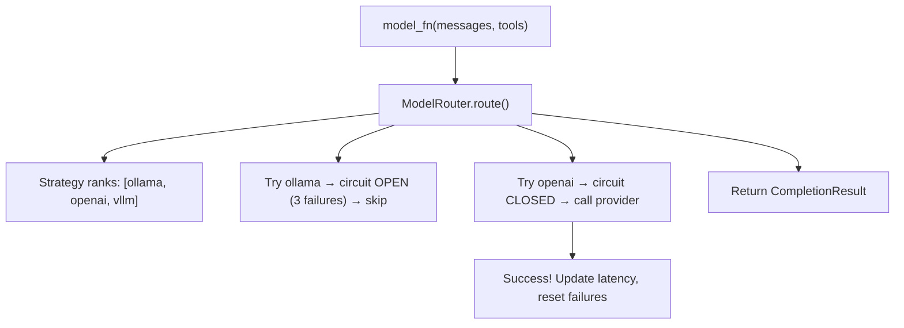

When a request reaches Astromesh, it passes through a 12-step pipeline before a response is returned. This page traces every step in detail -- what happens, which module handles it, and what data flows between stages.

For the architectural context behind this pipeline, see [Four-Layer Design](/astromesh/architecture/four-layer-design/). For the high-level system map, see [Architecture Overview](/astromesh/architecture/overview/).

## Pipeline Overview



---

## Step 1: Request Arrives

**Module:** `astromesh/api/routes/agents.py` or `astromesh/api/ws.py`

A request enters Astromesh through one of two interfaces:

### HTTP POST

```bash
curl -X POST http://localhost:8000/v1/agents/support-agent/run \
  -H "Content-Type: application/json" \
  -d '{"query": "How do I reset my password?", "session_id": "session-42"}'
```

The FastAPI route handler at `POST /v1/agents/{name}/run` receives the request, validates the JSON body (must contain `query` and `session_id`), and extracts the agent name from the URL path.

### WebSocket

```
ws://localhost:8000/v1/ws/agent/support-agent
```

The WebSocket handler at `/v1/ws/agent/{agent_name}` accepts the connection, registers it with the `ConnectionManager`, and waits for JSON messages. Each message triggers the same pipeline, but responses are streamed back token-by-token instead of returned as a single JSON response.

### Channel Adapter (WhatsApp)

For channel-based requests, the flow is slightly different. The WhatsApp adapter at `POST /v1/channels/whatsapp/webhook` receives Meta's webhook payload, validates the HMAC signature, extracts the message text, and spawns a **background task** to run the agent. This ensures the webhook responds to Meta within the required 5-second window. The agent's response is sent back to the user asynchronously via the WhatsApp Business Cloud API.

---

## Step 2: AgentRuntime.run()

**Module:** `astromesh/runtime/engine.py`

The route handler calls `runtime.run(agent_name, query, session_id)`. The Runtime Engine:

1. **Looks up the agent** by name in its internal dictionary of bootstrapped agents. If the agent does not exist, it returns a 404 error.
2. **Creates an execution context** containing the query, session ID, and any additional metadata (e.g., channel source, user identity).
3. **Delegates to `Agent.run()`**, which begins the execution pipeline.

```python
# Simplified flow
async def run(self, agent_name: str, query: str, session_id: str):
    agent = self.agents.get(agent_name)
    if not agent:
        raise AgentNotFoundError(agent_name)
    return await agent.run(query, session_id)
```

---

## Step 3: Input Guardrails

**Module:** `astromesh/core/guardrails.py`

Input guardrails run first, before memory, RAG, prefetch and the model. For a multimodal query they run on each text part separately. Rules run in the order declared and each one sees the text the previous one left. Everything after this step (memory context, RAG, the root span's `query` attribute, the orchestration pattern and the persisted user turn) sees the filtered text.

Each rule takes an action:

| Action | Effect |
|--------|--------|
| **Redact / truncate** | The text is modified and the pipeline continues |
| **Warn** | The text is untouched; the detection is recorded on the trace |
| **Block** | The pipeline stops and a structured rejection result is returned (see below) |

### Input rules

Every rule accepts `type`, `action` and `message` (the rejection text if the rule blocks; default `"I can't help with that request."`). The first action listed is the default.

| `type` | Keys | `action` |
|--------|------|----------|
| `pii_detection` | none | `redact` (default), `block`, `warn` |
| `topic_filter` | `blocked_topics` (alias `forbidden_topics`) | `warn` (default), `block` |
| `max_length` | `max_chars` (alias `max_characters`), default 10000 | `truncate` (default), `block` |
| `cost_limit` | `max_tokens_per_turn` (required), `count: output \| total` | always blocks; see [Step 10](#step-10-output-guardrails) |

`pii_detection` replaces emails, phone numbers, SSNs and card numbers with `[REDACTED_EMAIL]`, `[REDACTED_PHONE]`, `[REDACTED_SSN]` and `[REDACTED_CC]`. `topic_filter` matches case-insensitively by substring.

```yaml
spec:
  guardrails:
    input:
      - type: pii_detection
        action: redact
      - type: topic_filter
        blocked_topics: ["violence", "weapons"]
        action: block
        message: "I can't help with that."
      - type: max_length
        max_chars: 5000
        action: block
      - type: cost_limit
        max_tokens_per_turn: 4000
```

### Rejection result

A block is not an error: the run finishes normally and `answer` is the rule's `message`.

```json
{
  "answer": "I can't help with that.",
  "blocked": true,
  "guardrail": {"direction": "input", "rule": "topic_filter", "reason": "blocked topic"},
  "steps": [],
  "propuestas": [],
  "trace": {}
}
```

`steps` is always `[]` on a block: a rejection never ships the blocked content in any field. `propuestas` is shown for completeness (pending proposals, as in any run) and `trace` is the full trace of the run. When the agent declares an `output_schema`, any block also sets `data` to `null` and `data_error` to `"blocked by guardrail"`.

`direction` is `input`, `output` or `run` (for `cost_limit`). `reason` never repeats the blocked content. A run that is not blocked returns `blocked: false` and `guardrail: null`. The REST response and the WebSocket `done` event carry both fields.

An input block runs no memory, RAG or model call and persists no turn, so the blocked text never enters the history.

### Validation and limits

Rules are validated once when the agent loads. Nothing invalid stops the agent from loading: unknown or misplaced rule types, invalid actions and invalid regexes are discarded with a warning naming the agent, direction and index. `max_chars` must be a positive integer. A rule left with no topics or no valid patterns is discarded; an invalid individual pattern is dropped, and the rule itself is dropped only if no pattern remains. Unknown keys are ignored with a warning. `blocked_categories` and `allowed_topics` need a classifier, are not supported, warn at load and are ignored; use `blocked_patterns` or the system prompt instead.

Limits to know: PII patterns follow US formats (an Argentine phone number is not detected), topics match by substring, and there are no classifier-based rules.

---

## Step 4: Memory Context

**Module:** `astromesh/core/memory.py`

After input guardrails pass, the Memory Manager assembles context from all configured memory types by calling `build_context(agent_name, session_id, query)`.

### What happens during context building

1. **Conversational memory** -- The manager retrieves recent chat history for the given session. The configured memory strategy determines how much history is included:
   - `sliding_window`: Returns the last `max_turns` turns
   - `summary`: Returns an incremental summary of older turns plus the last `max_turns` turns verbatim
   - `token_budget`: Returns as many recent turns as fit the budget

   Whatever the strategy, the history is then trimmed to a real token budget (90% of the model's context window minus system prompt, tools, response `max_tokens` and `prompts.context`) -- see [Memory Manager](/astromesh/reference/core/memory-manager/#history-budget-and-delivery). If the window is unknown, only `max_turns` applies.

2. **Semantic memory** -- If semantic memory is configured, the query is embedded and a vector similarity search is performed against the semantic store. The top-K most relevant results are returned. This gives the agent access to long-term knowledge that may be relevant to the current query.

3. **Episodic memory** -- If episodic memory is configured, recent events (tool calls, significant outcomes, user feedback) for the session are retrieved. This gives the agent awareness of what has happened in the broader conversation context.

The output is a structured context object containing all three memory types, ready to be injected into the prompt template.

```
Memory Context Output:
├── conversation_history: [Message, Message, ...]
├── semantic_results: [{"content": "...", "score": 0.92}, ...]
└── episodic_events: [{"event": "tool_call", "tool": "search", ...}, ...]
```

---

## Step 5: Prompt Rendering

**Module:** `astromesh/core/prompt_engine.py`

The Prompt Engine takes the agent's system prompt template (a Jinja2 string from the `prompts.system` field in the agent YAML) and renders it with the assembled context variables.

### Template variables

The following variables are available in the system prompt template:

| Variable | Source | Content |
|----------|--------|---------|
| `agent_name` | Agent YAML `metadata.name` | The agent's name |
| `description` | Agent YAML `spec.identity.description` | The agent's description |
| `conversation_history` | Memory Manager | List of previous messages |
| `semantic_context` | Memory Manager | Relevant knowledge from vector search |
| `episodic_events` | Memory Manager | Recent events and tool call history |
| `current_date` | System | Current date/time string |
| Custom variables | Agent YAML `prompts.variables` | Any additional configured variables |

Manifest templates render in a Jinja sandbox (`ImmutableSandboxedEnvironment`, since core 0.59.1).

### SilentUndefined

The Prompt Engine uses Jinja2's `SilentUndefined` mode. This means if a variable is referenced in the template but not available (e.g., no semantic memory is configured), it renders as an empty string rather than raising an error. This allows a single prompt template to work correctly whether or not optional features like semantic memory are enabled.

### Rendered output

The system prompt is rendered **without** the conversation history, so it is identical between turns. The final message array is ordered:

```
system → tools → history (messages) → [glyph grammar] → prompts.context + query
```

`prompts.context` (a second Jinja2 template, for RAG `knowledge` and `prefetch`) is rendered per query and prepended to the current user message by the `react` and `glyph` patterns; other patterns get it appended to the system prompt. If `prompts.system` still iterates `memory.conversation`, the legacy path renders the history into the system prompt and sends no history messages.

### The `context_fit` span

Between memory build and the LLM call, the runtime measures the prompt, fits the history into the budget and records a `context_fit` span:

| Attribute | Meaning |
|-----------|---------|
| `context.window`, `context.window_source` | Model context window and where it came from |
| `context.base_tokens` | System prompt + tools + response `max_tokens` + context |
| `history.budget` | Tokens available for history (`-1` = unbounded, window unknown) |
| `history.turns_kept`, `history.turns_dropped`, `history.tokens` | What the budget kept |
| `history.delivery` | `messages` or `template` (legacy) |
| `history.summary_used` | Whether a summary was included |
| `turn_context.tokens`, `turn_context.delivery` | Size of `prompts.context` and how it was delivered (`message`, `system`, `none`) |

The `llm.complete` span adds `cache.hit_ratio` (`cached_tokens / input_tokens`) to show whether the provider's prompt cache is hitting.

---

## Step 6: Tool Schema Generation

**Module:** `astromesh/core/tools.py`

Before entering the orchestration loop, the Tool Registry generates JSON schemas for all tools available to this agent. These schemas follow the OpenAI function calling format and are passed to the LLM provider so it can decide when and how to call tools.

```json
{
  "type": "function",
  "function": {
    "name": "search_knowledge_base",
    "description": "Search the knowledge base for relevant information",
    "parameters": {
      "type": "object",
      "properties": {
        "query": {
          "type": "string",
          "description": "The search query"
        },
        "top_k": {
          "type": "integer",
          "description": "Number of results to return",
          "default": 5
        }
      },
      "required": ["query"]
    }
  }
}
```

The registry filters tools based on the agent's permissions -- each agent only sees the tools it is authorized to use, as specified in its YAML configuration.

---

## Step 7: Orchestration Pattern

**Module:** `astromesh/orchestration/patterns.py`, `supervisor.py`, `swarm.py`

The orchestration pattern controls the reasoning loop -- how the agent thinks, acts, and decides when it is done. The pattern receives two callable functions (`model_fn` for LLM calls and `tool_fn` for tool execution) and iterates until it produces a final answer or hits the configured `max_iterations` limit.

### ReAct Example (most common pattern)

The ReAct (Reasoning + Acting) pattern is the most widely used. Here is how a single iteration works:

```
Iteration 1:
┌─────────────────────────────────────────────────┐
│ THINK: LLM receives messages + tool schemas     │
│        LLM decides: "I need to search the KB"   │
│                                                 │
│ ACT:   LLM returns tool_call:                   │
│        search_knowledge_base(query="password    │
│        reset procedure")                        │
│                                                 │
│ OBSERVE: Tool executes, returns results:        │
│          "To reset your password, go to..."     │
│          Result is added to message history     │
└─────────────────────────────────────────────────┘

Iteration 2:
┌─────────────────────────────────────────────────┐
│ THINK: LLM receives updated messages (with      │
│        tool results)                            │
│        LLM decides: "I have enough info"        │
│                                                 │
│ ACT:   LLM returns a text response (no tool     │
│        call) → this is the final answer         │
└─────────────────────────────────────────────────┘
```

When one LLM response asks for several tools, ReAct appends **one** assistant message carrying the full `tool_calls` list, followed by one `tool` message per call, paired by `tool_call_id` — the shape the OpenAI protocol defines. Before `0.48.0` it appended an assistant message per tool call, each repeating the response's `content` and `reasoning_content`; since the transcript is re-sent on every later iteration, a thinking model's reasoning was paid once per tool, on every turn.

### Other patterns

**PlanAndExecute** first asks the LLM to create a numbered plan, then executes each step sequentially, calling tools as needed at each step.

**ParallelFanOut** sends the query to multiple providers simultaneously and merges the results. Useful for getting diverse perspectives or ensemble-style responses.

**Pipeline** chains processing stages (`orchestration.stages`, 2 to 6 names; default `analyze`, `process`, `synthesize`), where each stage's output becomes the next stage's input. Useful for data transformation workflows.

**Supervisor** is a coordinator that only delegates: its workers are the manifest's `type: agent` tools, offered to the model as native tool calls (an agent with none fails to load).

**Swarm** is meant for handoff between peer agents, but handoff is not wired in the runtime yet: see [Multi-Agent](/astromesh/configuration/multi-agent/#swarm-pattern).

---

## Step 8: Model Routing

**Module:** `astromesh/core/model_router.py`

Within each orchestration iteration, when the pattern needs an LLM completion, it calls `model_fn()`, which delegates to the Model Router.

The Model Router performs the following sequence:

1. **Rank providers** using the configured routing strategy (e.g., `cost_optimized` sorts by `estimated_cost()`, `latency_optimized` sorts by `avg_latency_ms`).

2. **Check circuit breaker** for the top-ranked provider. If the circuit is open (the provider has failed 3+ times recently and the 60-second cooldown has not elapsed), skip to the next provider.

3. **Call the provider** via `provider.complete()` (or `provider.stream()` for WebSocket). Pass the rendered messages and tool schemas.

4. **Handle failure** -- If the provider call fails (network error, timeout, API error), increment the failure counter, and try the next provider in the ranked list.

5. **Update metrics** -- On success, update the provider's latency moving average and reset its failure counter. Record the token usage for cost tracking.



If all providers fail, the router raises an error that propagates back through the pipeline.

---

## Step 9: Tool Execution

**Module:** `astromesh/core/tools.py`

If the LLM's response includes a tool call (a structured request to invoke a specific function with arguments), the orchestration pattern intercepts it and delegates to the Tool Registry.

The Tool Registry:

1. **Validates the tool call** -- Checks that the tool exists, the agent has permission to use it, and the rate limit has not been exceeded.
2. **Deserializes arguments** -- Parses the JSON arguments from the LLM's tool call.
3. **Executes the tool** based on its type:
   - **Internal**: Calls the registered Python async function directly
   - **MCP**: Sends a JSON-RPC request to the MCP server
   - **Webhook**: Makes an HTTP request to the configured endpoint
   - **RAG**: Runs a query through the RAG pipeline
   - **Agent**: Invokes the target agent's full pipeline via `AgentRuntime.run()` (see [Nested Agent Execution](#nested-agent-execution) below)
4. **Returns the result** -- The tool's output is formatted as a tool result message and added to the conversation, so the LLM can see it in the next iteration.

```python
# Simplified tool execution
async def execute(self, tool_name: str, arguments: dict, agent_name: str):
    tool = self.tools[tool_name]

    # Permission check
    if tool_name not in self.agent_permissions[agent_name]:
        raise ToolPermissionError(tool_name, agent_name)

    # Rate limit check
    if self.is_rate_limited(tool_name, agent_name):
        raise ToolRateLimitError(tool_name)

    # Execute based on type
    match tool.type:
        case "internal":
            return await tool.function(**arguments)
        case "mcp":
            return await self.mcp_client.call_tool(tool.server, tool_name, arguments)
        case "webhook":
            return await self.http_client.post(tool.endpoint, json=arguments)
        case "rag":
            return await self.rag_pipeline.query(arguments["query"])
```

After tool execution, the result is appended to the message history and the orchestration pattern loops back to Step 8 for the next iteration.

### Nested Agent Execution

When a tool has `type: agent`, tool execution triggers a complete nested pipeline. The ToolRegistry calls `AgentRuntime.run()` for the target agent, which goes through steps 2--12 of this pipeline independently. The target agent has its own memory, guardrails, orchestration pattern, and tools.

**What comes back:** the observation handed to the parent's model is the child's `answer` (plus `data` / `data_error` when the child declares an `output_schema`) — not its `steps` and not its `trace`. Before `0.55.0` the whole run dict came back and was stringified into the parent's message history, which meant every sub-agent call carried the child's prompts and tool results into every later turn of the parent's loop: around 13,000 extra input tokens per call, paid on each turn.

**Trace continuity:** the child's run is traced in full and `Agent.run` emits that trace to the collector itself, so nothing about the child's execution is lost. But parent and child are **two separate traces today**: the runtime accepts a `parent_trace_id` and would adopt it as the child's `trace_id`, and the agent tool path reads it from the execution context — which never carries one. Correlate by session and timestamp; the parent's `tool.call` span records the arguments and a truncated string of the result.

```
Trace: parent-abc                    Trace: child-def
agent.run (parent-agent)             agent.run (child-agent)
├── memory_build                     ├── memory_build
├── prompt_render                    ├── prompt_render
├── orchestration                    ├── orchestration
│   ├── llm.complete                 │   ├── llm.complete
│   ├── tool.call (child-tool)  ····▶│   └── tool.call (regular-tool)
│   └── llm.complete                 └── memory_persist
└── memory_persist
```

**Context transforms:** If the agent tool has a `context_transform` defined, the ToolRegistry renders the Jinja2 template with the LLM's tool call arguments and passes the resulting JSON as the `context` parameter to the child agent. This context is available in the child agent's prompt template variables, allowing data to be reshaped between agent boundaries.

**Circular reference safety:** At bootstrap, `_detect_circular_refs()` builds a directed graph of agent-to-agent dependencies and runs DFS cycle detection. If a cycle is found (e.g., agent A calls agent B calls agent A), bootstrap fails immediately with a `ValueError`. This prevents infinite recursion at runtime.

For a full guide on configuring multi-agent systems, see [Multi-agent Composition](/astromesh/configuration/multi-agent/).

---

## Step 10: Output Guardrails

**Module:** `astromesh/core/guardrails.py`

Output guardrails run on the final `answer` right after the orchestration pattern returns, before the pending-confirmation notice, memory persistence and `output_schema` parsing. Because `data` is built from the filtered answer, it cannot leak what `answer` hides.

The same rules also filter the text fields of `steps` (`thought`, `observation`, `result`) and the trace's model-response and step attributes in the run response. Tool arguments (`action_input`, `tool_call` events) are not filtered. The confirmation notice for a pending `needs_confirmation` action is appended after output filtering, so the person sees exactly the arguments that will run.

### Output rules

| `type` | Keys | `action` |
|--------|------|----------|
| `pii_detection` | none | `redact` (default), `block`, `warn` |
| `content_filter` | `blocked_patterns` (regex, case-insensitive), `forbidden_keywords` (literal strings) | `redact` (default), `block` |
| `cost_limit` | `max_tokens_per_turn` (required), `count: output \| total` (default `output`) | always blocks |

`content_filter` with `redact` replaces every match with `[FILTERED]`; with `block` the run returns the rejection result from [Step 3](#rejection-result) with `direction: "output"` and `answer` set to the rule's `message`. `topic_filter` does not apply to output and is discarded with a warning.

### Streaming

The `token` events of a streamed run carry the full response of each model call. With output rules declared, each event's `content` goes through the same rules before it is emitted; if a rule blocks it, that event is not emitted. `cost_limit` does not filter individual events, but the budget still applies: a streamed run is stopped by it like any other.

### Cost limit

`cost_limit` is a token budget for the whole run, not a length cap. Each model response adds its provider-reported `usage.output_tokens` (or input plus output with `count: total`) to a per-run counter, and the counter is checked before each model call. If it has already reached `max_tokens_per_turn`, the run stops with a rejection result (`direction: "run"`). The call that crosses the limit completes; the budget is checked before spending, so a response is never cut in half. A response without `usage` counts as 0. It can be declared under `input` or `output`; if you declare two, the lower one wins. Because the check happens before each call, under the `parallel_fan_out` pattern several concurrent calls can pass it together and the run can exceed the budget by up to one call per concurrent subtask.

```yaml
spec:
  guardrails:
    output:
      - type: content_filter
        blocked_patterns: ["internal[-_ ]only"]
        forbidden_keywords: ["classified"]
        action: redact
      - type: pii_detection
        action: redact
      - type: cost_limit
        max_tokens_per_turn: 4000
        count: total
```

### Persistence on a block

An output block, or a `cost_limit` stop, persists the user turn (already filtered) and the rejection message as the assistant turn. If the blocked run had registered an unconfirmed proposal, it is discarded, so a later "yes" cannot authorize something the user never saw.

### Limits

Output guardrails filter the final `answer`, `data`, the text fields of `steps`, the trace's model-response and step attributes, and streamed `token` events; tool arguments are not filtered. PII patterns follow US formats (an Argentine phone number is not detected), there are no classifiers (`blocked_categories` and `allowed_topics` warn at load and are ignored), and invalid rules are discarded with a warning. Each agent applies only its own rules: a sub-agent does not inherit its parent's.

---

## Step 11: Memory Persistence

**Module:** `astromesh/core/memory.py`

After output guardrails pass, the Memory Manager persists the conversation turn. Two calls are made:

1. **`persist_turn(user_message)`** -- Stores (with its token count) the user's original query, never the `prompts.context` text (after input guardrail redaction, if any) as a conversation turn.
2. **`persist_turn(assistant_message)`** -- Stores the agent's final response as a conversation turn.

Both turns are written to the configured conversational memory backend (Redis — the only one the factory builds) and associated with the session ID.

If **episodic memory** is configured, significant events from the execution are also recorded:
- Tool calls made (tool name, arguments, result summary)
- Provider used and latency
- Total token usage and estimated cost

With `strategy: summary`, once `max_turns` is exceeded the assistant turn also triggers one inline call to the `summarizer` role that folds the turns leaving the verbatim window into the running summary.

If **semantic memory** is configured and the agent has auto-indexing enabled, the assistant's response may be embedded and stored in the vector store for future retrieval.

---

## Step 12: Response

**Module:** `astromesh/api/routes/agents.py` or `astromesh/api/ws.py`

The final response is returned to the caller in the format appropriate for the transport:

### HTTP Response

```json
{
  "response": "To reset your password, go to Settings > Security > Reset Password...",
  "agent": "support-agent",
  "session_id": "session-42",
  "metadata": {
    "provider": "ollama",
    "model": "llama3.1:8b",
    "tokens_used": 342,
    "latency_ms": 1250,
    "tools_called": ["search_knowledge_base"]
  }
}
```

### WebSocket Response

For WebSocket connections, the response was already streamed token-by-token during Step 8. The final message includes the complete response and a `done: true` flag.

### Channel Response

For channel-based requests (e.g., WhatsApp), the agent's response is sent back to the user through the channel's API (e.g., WhatsApp Business Cloud API) by the background task spawned in Step 1.

---

## Configuration Loading Flow

Before the pipeline can run, configuration files must be loaded and parsed. This happens once at startup during `AgentRuntime.bootstrap()`.

```
config/
├── agents/*.agent.yaml    ──► AgentRuntime.bootstrap()
│                               ├── Parse YAML
│                               ├── Validate apiVersion + kind
│                               ├── Build ModelRouter
│                               │   ├── Instantiate primary provider
│                               │   ├── Instantiate fallback providers
│                               │   └── Set routing strategy
│                               ├── Build MemoryManager
│                               │   ├── Select conversational backend
│                               │   ├── Select semantic backend (optional)
│                               │   ├── Select episodic backend (optional)
│                               │   └── Set memory strategy
│                               ├── Detect circular agent refs (DFS)
│                               ├── Build ToolRegistry
│                               │   ├── Register internal tools
│                               │   ├── Connect to MCP servers
│                               │   ├── Register webhook tools
│                               │   ├── Register RAG tools
│                               │   └── Register agent tools
│                               ├── Select OrchestrationPattern
│                               ├── Build PromptEngine
│                               │   └── Register system prompt template
│                               ├── Build GuardrailsEngine
│                               │   ├── Configure input guardrails
│                               │   └── Configure output guardrails
│                               └── Create Agent instance
│
├── providers.yaml         ──► Provider registration (endpoints, credentials)
├── rag/*.rag.yaml         ──► RAG pipeline configuration
├── channels.yaml          ──► Channel adapter configuration
└── runtime.yaml           ──► API and runtime defaults (port, log level, etc.)
```

---

## Data Flow Diagram

This diagram maps each pipeline step to the module that handles it:

```
Step                        Module                          Layer
────                        ──────                          ─────
1.  Request Arrives         api/routes/agents.py            API Layer
                            api/ws.py
                            channels/whatsapp.py

2.  AgentRuntime.run()      runtime/engine.py               Runtime Engine

3.  Input Guardrails        core/guardrails.py              Core Services

4.  Memory Context          core/memory.py                  Core Services
                            memory/backends/*               Infrastructure
                            memory/strategies/*             Infrastructure

5.  Prompt Rendering        core/prompt_engine.py           Core Services

6.  Tool Schema Gen         core/tools.py                   Core Services

7.  Orchestration           orchestration/patterns.py       Infrastructure
                            orchestration/supervisor.py
                            orchestration/swarm.py

8.  Model Routing           core/model_router.py            Core Services
                            providers/*                     Infrastructure

9.  Tool Execution          core/tools.py                   Core Services
                            mcp/client.py                   Infrastructure
                            rag/pipeline.py                 Infrastructure

10. Output Guardrails       core/guardrails.py              Core Services

11. Memory Persistence      core/memory.py                  Core Services
                            memory/backends/*               Infrastructure

12. Response                api/routes/agents.py            API Layer
                            api/ws.py
```

Each step cleanly separates the orchestration logic (Core Services) from the concrete implementations (Infrastructure), maintaining the strict layer boundaries described in [Four-Layer Design](/astromesh/architecture/four-layer-design/).
