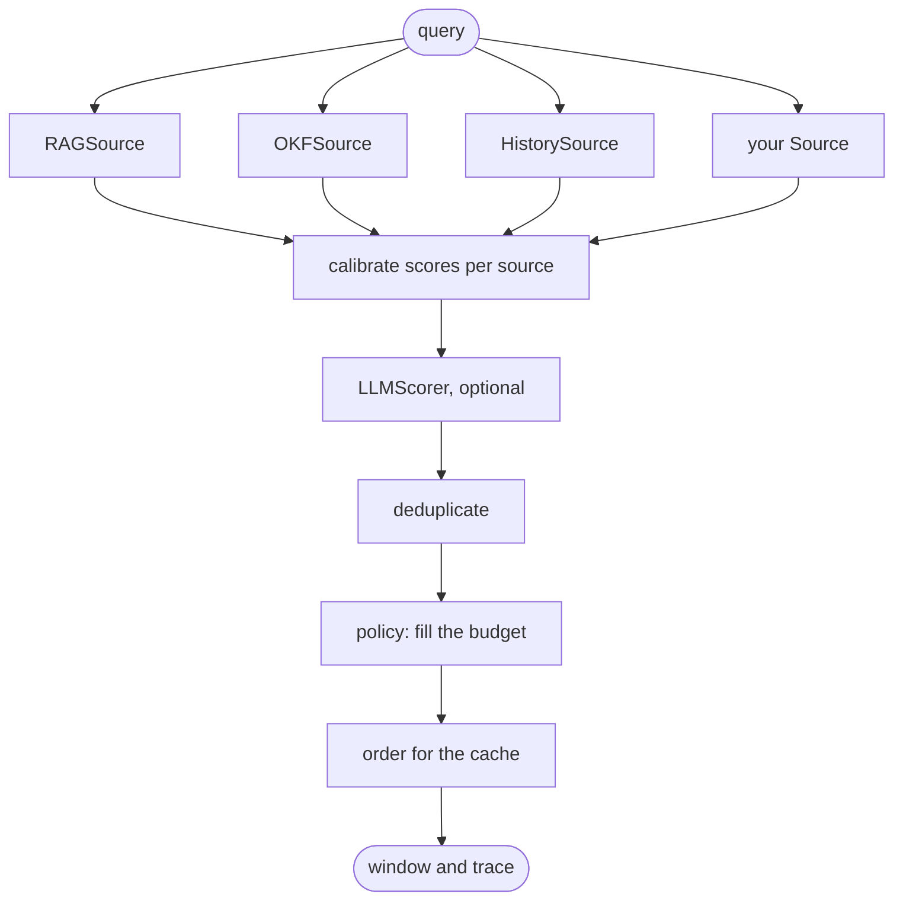

**astromesh-context** decides what goes into an
agent's context window. Retrieval brings candidates, a knowledge base brings curated concepts,
memory brings what the agent learned, and the conversation keeps growing. Something has to
decide which of all that fits, in what order, and what stays out. Today that decision is
scattered across prompt templates, a `top_k` in one place and a history trim in another, and
nothing tells you whether it was a good one.

This library makes the decision in one place:

- **One budget for every source.** RAG hits, OKF concepts, memory facts and chat history
  compete for the same tokens on a calibrated score, instead of each getting a fixed slice.
- **A trace for every item.** Everything a source proposed comes back marked included or
  excluded, with the reason: `budget`, `duplicate_of:…`, `below_floor`, `source_cap`,
  `deprecated`.
- **An order built for the prompt cache.** Stable content first, byte for byte, so
  consecutive calls share the longest possible prefix.
- **An eval that measures it.** `ContextEval` runs the same questions under different
  policies and reports recall, tokens spent and prefix reuse side by side.

[RAG](/astromesh/rag/introduction/) and [OKF](/astromesh/okf/introduction/) decide *what could
be relevant*. Context decides *what the model actually reads*. Where it sits among the other
ways to give an agent knowledge is laid out in
[The map of context patterns](/astromesh/context/patterns/).

## How a window is built



Sources run in parallel and only **propose**: none of them knows the budget. Everything after
them is a pure function, so the same candidates and the same policy always give the same window.

1. **Calibrate.** A cosine of 0.82, a BM25 score of 14 and "the third most recent turn" are not
   comparable. Scores are normalized by rank within each source, then weighted by how much you
   trust that source. OKF signals adjust them where you can see it: a stale concept scores lower,
   a human-reviewed one higher, a deprecated one is left out.
2. **Score with a model (optional).** `LLMScorer` rescores the top candidates in one batched
   call and blends its score with the calibrated one. If it fails or times out, the window is
   built anyway on the calibrated scores and the trace says so.
3. **Deduplicate.** Exact copies by hash, near-copies by containment of 5-word shingles: the
   overlap divided by the size of the smaller text, at 0.8 or more. A retrieval chunk is
   recognized as part of the concept it came from. The copy that stays inherits the dropped
   one's signals, so a RAG chunk of a policy that OKF marks deprecated goes out with it. This is
   what catches RAG and OKF returning the same policy twice. Conversation history is never
   deduplicated.
4. **Fill the budget.** Pinned items (the system prompt, the OKF root index) go in first. Then a
   minimum per source (the last user turn, always), then the rest by score, within a cap per
   source and above a score floor. Weighting by value per token exists as `beta` and defaults to
   0: it lost at tight budgets on the published corpus (see [Eval](/astromesh/context/eval/)). If the pinned items alone exceed the budget, the
   build fails with an explicit error rather than trimming them silently.
5. **Order for the cache.** Stable items first in a fixed order, then session items, then
   volatile ones, with the strongest at the edges of their block, where models read best. History stays chronological
   and last.

## Using it

```python
# needs: astromesh_rag, astromesh_okf
engine = ContextEngine(
    sources=[
        StaticSource(system_prompt, kind="instruction", pinned=True),
        OKFIndexSource("./kb"),            # the bundle index, pinned in the stable prefix
        OKFSource("./kb", limit=10),       # whole concepts, with trust and freshness
        RAGSource(pipeline, k=20),         # chunks from an astromesh-rag pipeline
        HistorySource(messages),           # the conversation, newest turn always kept
    ],
    policy=ScoredKnapsack(),
    budget=8_000,
)
window = await engine.build("Can I get a refund after 3 weeks on the Team plan?")
```

The full, runnable version is in the [Quickstart](/astromesh/context/quickstart/). The same
engine loads from `kind: ContextPolicy` YAML with `load_engine`.

## Failures degrade, they do not fail

A source that raises or times out is left out and the trace records `source_error:<name>`. If
`LLMScorer` fails, the window is built on the calibrated scores and the trace records
`scorer_fallback:<reason>`. Two cases do raise: pinned items that alone exceed the budget, and
`Everything` without `truncate` when the candidates do not fit (both `BudgetExceededError`).
Nothing is trimmed silently.

## Policies

A policy decides how candidates fill the budget. All three share one signature, so the eval
compares them as equals. Details and defaults are in [Policies](/astromesh/context/policies/).

| Policy | What it does | Use it for |
|---|---|---|
| `ScoredKnapsack` | One budget, calibrated scores, caps, minimums and floors per source; `beta` adds value-per-token weighting (default 0) | The default |
| `FixedSlots` | A fixed share of the budget per source, filled in priority order | The baseline most stacks run today |
| `Everything` | Every candidate, or a clear error if they do not fit (`truncate=True` fills by score instead) | The control: what "just stuff it all in" costs |

`LLMScorer` is not a policy: it is a scoring step that works with any of them.

## Inside the agent loop

Two optional pieces for long-running agents. They use the same types and do not need the
engine: each works on a plain list of OpenAI or Anthropic messages, or on your framework's own
messages through a `MessageAdapter`.

- **`Compactor`** summarizes old turns once history crosses a threshold and keeps the last turns
  verbatim. It never splits a tool call from its result, which providers reject.
- **`Offloader`** moves a tool result over the limit into a store and leaves a preview and a
  handle. The agent reads what it needs with `ctx_read(handle, offset, limit)` and
  `ctx_grep(handle, pattern)`.

## How it relates to the Astromesh core

The core assembles context today in several places: `MemoryManager.build_context` gathers
memory, `fit_history` trims the conversation to a budget, and RAG and OKF content reaches the
prompt through Jinja prefetch or tools. Nothing arbitrates between them. The plan is for the core
to adopt this library, the way it adopted `astromesh-okf` in 0.69; that is a separate change and
has not happened yet.

## Status and license

Version 0.1.0 is on PyPI: `pip install astromesh-context`. It ships the engine, the three
policies, `LLMScorer`, sources for RAG, OKF, history, static and callable content, `Compactor`
and `Offloader`, `ContextEval` with a published level-1 comparison, integrations for LangChain,
PydanticAI and MCP, and `kind: ContextPolicy` YAML. Not yet: level-2 answer-accuracy results
(pending review of the reference answers), more framework integrations, a graph source and
adoption by the Astromesh core. Licensed under Apache-2.0. Source:
[github.com/monaccode/astromesh-context](https://github.com/monaccode/astromesh-context).
