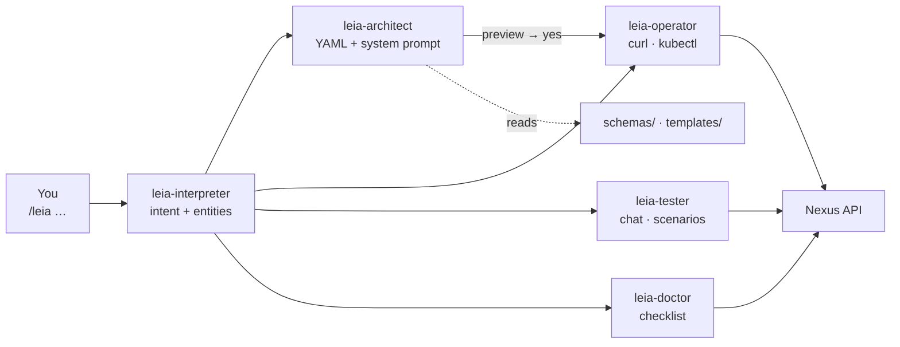

import { Aside } from '@astrojs/starlight/components';

<p style="text-align:center; margin: 0.5rem 0 1.75rem;">
  
</p>

**Astromesh Leia** is a [Claude Code](https://claude.com/claude-code) plugin. You describe the
agent you need, in English or Spanish, and Leia designs a complete `astromesh/v1` manifest with
a real system prompt, shows it to you, and can deploy it, test it and diagnose it on a
[Nexus](/astromesh/nexus/introduction/) hub. It is named after Leia, the author's lemon beagle: a scent hound, bred to follow a trail
until it finds what it was sent for — which is the job here too.

<Aside type="note" title="v0.11.0 knows the whole ecosystem">
Leia 0.11 knows every published component and understands requests in Spanish: ask "¿uso
astromesh-rag o knowledge.pipeline?" or "quiero que sea el agente nativo de GCP" and it points at
the right one, with its status (Prisma in development, Centinela in preview). It is synced to core
0.74.1 and Nexus 0.28.2. It designs `type: a2a` tools (an agent that
calls a remote A2A agent), publishes agents over A2A with `spec.a2a.publicar` and `spec.skills`,
and checks the [Agent Card](/astromesh/nexus/a2a-server/) after a deploy. Operations authenticate
with `X-API-Key` (since 0.8). See [Compatibility](#compatibility).
</Aside>

## What Leia is

- **Prompts, not a program.** Leia is ten slash commands, five subagents, six templates and eight
  reference schemas, all Markdown and YAML. Claude Code runs them; the actual work happens
  through `curl`, `kubectl` and `ollama` on your machine.
- **An agent designer.** Its architect subagent knows the agent schema up to astromesh core
  0.74.1: per-role models, the real orchestration patterns, `spec.chain`,
  `spec.output_schema`, every tool type that loads (including `integration`, `api`, `mcp` and
  `a2a`), `prefetch`, `prompts.context`, OKF knowledge bundles, guardrails, permissions,
  `spec.skills` and A2A publishing, and the version each one needs.
- **A guide to the ecosystem.** `schemas/ecosystem.md` lists the current version of every
  component and when to point at each library: `astromesh-a2a` for agents in other frameworks,
  `astromesh-okf` to check a bundle, `astromesh-rag` and `astromesh-context` for your own code.
- **A deploy-and-test loop** for a Nexus hub: publish, poll, chat with the agent, run scored
  test scenarios, and walk a diagnostic checklist when something fails.

It is not a hosted service, a GUI or an agent framework. The agents it builds run on Nexus and
the Astromesh runtime.

## How it works



| Subagent | Model | Does |
|---|---|---|
| `leia-interpreter` | Sonnet | Turns a sentence into an intent (create, deploy, status, test, diagnose…) and entities (business, channel, name, tenant, vertical), then routes |
| `leia-architect` | Opus | Reads the bundled schemas and the closest template, checks `ollama list`, picks a pattern, and writes the manifest |
| `leia-operator` | Sonnet | Calls the Nexus API with `curl` and the cluster with `kubectl` |
| `leia-tester` | Sonnet | Proxies a chat to the agent, or runs five scenarios and scores them |
| `leia-doctor` | Sonnet | Walks a fixed checklist, stops at the first failure, and gives a root cause and the fix |

## Compatibility

| Leia | Nexus | Astromesh core knowledge |
|---|---|---|
| 0.11.x | 0.26 – 0.28.x | 0.29 – 0.74.x |
| 0.10.x | 0.26 – 0.28.x | 0.29 – 0.74.x |
| 0.9.x | 0.26.x | 0.29 – 0.71.x |
| 0.8.x | 0.26.x | 0.29 – 0.70.x |
| 0.7.x | 0.3.x | 0.29 – 0.70.x |
| 0.6.x | 0.3.x | 0.29 – 0.68.x |
| 0.5.x | 0.3.x | 0.29 – 0.38.x |
| 0.4.x | 0.3.x | 0.29 – 0.36.x |
| 0.2.x | 0.3.x | 0.18 – 0.28.9 |

From 0.8.0 the operator, tester, doctor, `bootstrap` and `logs` send the API key in `X-API-Key`,
and the bundled `schemas/nexus-api.md` describes Nexus 0.26.11: `/run`, `/run/stream`,
invocations, usage, versions, subscriptions and the `/admin` plane. The tester reads the 0.70
response (`blocked`/`guardrail`, `propuestas`, `usage.by_model`): an expected block passes, an
unexpected one fails and names the rule. Nexus 0.26.11 does not forward `blocked`/`guardrail`
(0.26.12 does), so against 0.26.11 the tester infers the block from the `answer`.

Leia 0.10 adds the A2A server of Nexus 0.27–0.28.2 to `nexus-api.md`: card, `SendMessage`
(blocking or `returnImmediately`), streaming, `GetTask`, `CancelTask`, `SubscribeToTask`,
`ListTasks` and the run usage part. Publishing needs Nexus 0.27+, `spec.skills` core 0.73+ and
`type: a2a` tools core 0.74+; the rest works against any 0.26.x.

Leia 0.7.x and earlier target Nexus 0.3.x; against 0.26.x design with them and publish the YAML
with [Cortex](/astromesh/cortex/nexus/) or the [Nexus API](/astromesh/nexus/api-reference/):

```bash
curl -X POST "$NEXUS_URL/api/v1/agents" \
  -H "X-API-Key: $NEXUS_API_KEY" -H "Content-Type: application/yaml" \
  --data-binary @agents/my-agent.yaml
```

## What each release taught it

Leia's value is what the architect knows, so each release is a knowledge sync with a core
version.

| Version | Synced to | Added |
|---|---|---|
| **0.11.0** | Nexus 0.28.2, core 0.74.1 | A request-to-component table at the top of `schemas/ecosystem.md` (Spanish and English); Cortex 0.29, Forge 0.29.1, Glyph, Orbit vs. Prisma and Nebula/Centinela with their status; Spanish verbs mapped to every intent; the context eval's level 2 marked as not run. |
| **0.10.0** | Nexus 0.28.2, core 0.74.1 | `type: a2a` tools (`card_url`, `auth` by env var name, `policy`) and the warning that the Nexus pool has no tenant env vars; `spec.skills`, `spec.a2a.publicar` and `origen` (an agent's turn never confirms a write); sub-agent usage counted in the parent's `cost_limit` and billed; the Nexus A2A server in `nexus-api.md`; an A2A check in the operator, doctor and tester; `schemas/ecosystem.md`. |
| **0.9.0** | Nexus 0.26.13, core 0.71.0 | Schemas and the architect at core 0.71: `permissions` (fnmatch over registered tool names, denied wins), semantic/episodic memory scoped to the session, real `swarm` handoff with `max_handoffs`, enforced `timeout_seconds` (120 s recommended); `/leia logs` marks invocations blocked by a guardrail. |
| **0.8.0** | Nexus 0.26.11, core 0.70.0 | Operations use `X-API-Key` (Bearer gave `401`); `nexus-api.md` rewritten for 0.26.11; the tester understands `blocked`/`guardrail`, `propuestas` and `by_model`; `kind: Eval`, OKF bundle and `RAGPipeline` schemas; `/leia deploy --node` for standalone nodes. |
| 0.7.0 | core 0.70.0 | Guardrails are enforced in core 0.70, so the architect emits them again: the real rule types per side, `message`, and the cautions (no input PII redaction when tools need IDs or phones, `cost_limit` ≈ 4000 for the whole run, US-format PII patterns). Templates carry input `max_length` and `cost_limit`, and output PII redaction where it fits. |
| 0.6.0 | core 0.68.0 | The whole manifest again: `integration`, `api` and `mcp` tools with `confirm`/`mode`, `prefetch`, `prompts.context` and `context_window`, `max_result_tokens`, pipeline `stages`, Glyph, and `spec.knowledge` with OKF bundles. It also says what 0.68 accepts but never applies: `spec.guardrails`, `permissions.allowed_actions`, semantic and episodic memory, a swarm handoff, `orchestration.timeout_seconds` |
| 0.5.0 | core 0.38.1 | `spec.chain` and `spec.output_schema`: when to offer them, that every agent in `on_complete` must be deployed first, and that an older runtime ignores both silently. The doctor checks chain declarations |
| 0.4.0 | core 0.36.0 | Only `builtin`, `agent` and `client` tools load from YAML; which model keys each source reads; the streaming contract and `usage.by_model`; RAG pipeline and workflow endpoints |
| 0.3.0 | core 0.29.0 | Per-role models (`default` + `roles`), `litellm`, the roles each pattern asks for |
| 0.2.1 | core 0.28.9 | Moonshot / Kimi through `openai_compat` |
| 0.2.0 | core 0.28.5, Nexus 0.3.0 | Fixed templates that the runtime silently ignored (flat `memory`, `limit` instead of `max_chars`) and invalid patterns; dual auth |

<Aside type="note">
The architect's knowledge stops at core 0.74.1. Fields added to the core after that are not in
its schemas; for those, author in [Cortex](/astromesh/cortex/authoring/).
</Aside>

## Next steps

- [Quick Start](/astromesh/leia/quickstart/) — install the plugin and design your first agent
- [Command Reference](/astromesh/leia/commands/) — every command, step by step
- [Templates & Agents](/astromesh/leia/templates/) — the templates, the subagents and the bundled schemas
