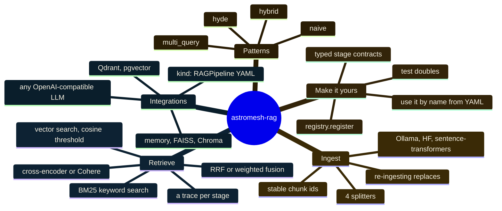

import { Aside } from '@astrojs/starlight/components';

**astromesh-rag** gives a model the documents it needs to answer, at the moment it answers.
It builds every step of retrieval-augmented generation (RAG) from small, swappable parts, in
Python or in YAML. The four patterns it ships — `naive`, `hybrid`, `multi_query` and `hyde` —
are different wirings of the same parts, so you switch pattern by changing one line and read
in the `trace` exactly what each stage did. The library itself depends only on PyYAML; every
model and database is an optional extra.

```bash
pip install "git+https://github.com/monaccode/astromesh-rag@v0.1.0"
```

Add the extra you need after the URL, for example
`"astromesh-rag[sentence-transformers] @ git+https://github.com/monaccode/astromesh-rag@v0.1.0"`.

<Aside type="note" title="Status">
Version 0.1.0 is tagged on [GitHub](https://github.com/monaccode/astromesh-rag/releases/tag/v0.1.0)
and published on TestPyPI; publication on PyPI is pending. CI is green on Python 3.10–3.13,
including integration jobs against a real Qdrant and a real Postgres with pgvector.
</Aside>

## Four steps, every time

Every RAG system does the same four things:

1. **Ingest.** Split your documents into chunks, turn each chunk into a vector, store it.
2. **Retrieve.** Turn the question into a vector and find the nearest chunks; optionally
   search keywords too, or let an LLM rewrite the question first.
3. **Rank.** Merge the lists, rerank the candidates with a sharper model, keep the best `k`.
4. **Answer.** Join the winners into a context block your model reads before it answers.



## Patterns at a glance

A pattern decides how the question becomes candidates. Everything after that — fusion,
optional reranking, the top `k`, the context — is shared.

| Pattern | Built for | Work per query | Needs an LLM? |
|---|---|---|---|
| `naive` | Questions worded like the documents | 1 embedding, 1 vector search | No |
| `hybrid` | Exact tokens: error codes, SKUs, names, versions | 1 embedding, vector and BM25 in parallel, fusion | No |
| `multi_query` | Users who say it differently from the docs | 1 LLM call, then 1 + N embeddings and searches, fusion | Yes |
| `hyde` | Short questions against long reference text | 1 LLM call, then 2 embeddings and searches, fusion | Yes |

Reranking is a switch on any pattern: a cross-encoder (or Cohere) rescores the candidates,
at the cost of one extra model pass over them. [Patterns](/astromesh/rag/patterns/) has a
diagram, the YAML and the failure modes for each one; the [benchmark](/astromesh/rag/benchmark/)
is how to check which one wins on your kind of questions.

## In Python

```python
from astromesh_rag import Document
from astromesh_rag.embedders import SentenceTransformersEmbedder
from astromesh_rag.indexes import MemoryIndex
from astromesh_rag.patterns import hybrid
from astromesh_rag.pipeline import IngestPipeline
from astromesh_rag.retrievers import BM25Index
from astromesh_rag.splitters import RecursiveSplitter

docs = [
    Document("ERR-4012: your upload link expired. Request a new one.", id="err-4012"),
    Document("ERR-4013: your storage quota is full. Free space or upgrade.", id="err-4013"),
]

embedder, index, bm25 = SentenceTransformersEmbedder(), MemoryIndex(), BM25Index()
await IngestPipeline(RecursiveSplitter(), embedder, index, bm25).ingest(docs)
result = await hybrid(embedder, index, bm25).query("What does ERR-4012 mean?", k=1)
print(result.context)  # ERR-4012: your upload link expired. Request a new one.
print(result.trace)    # retrieve vector, retrieve bm25, fuse, context
```

## In YAML

The same `kind: RAGPipeline` format the Astromesh runtime loads. Every key and default is in
the [YAML reference](/astromesh/rag/yaml-reference/).

```yaml
apiVersion: astromesh/v1
kind: RAGPipeline
metadata:
  name: support-docs
spec:
  chunking: { strategy: recursive, chunk_size: 800, overlap: 80 }
  embeddings: { provider: sentence_transformers, model: all-MiniLM-L6-v2 }
  vector_store: { backend: memory }
  reranking: { enabled: true, provider: cross_encoder, top_k: 5 }
  retrieval:
    pattern: hybrid
    top_k: 5
    candidates: 20
```

```python
from astromesh_rag.spec import build, load_spec_file

pipeline = build(load_spec_file("support.rag.yaml"))
await pipeline.ingest(docs)
result = await pipeline.query("What does ERR-4012 mean?")
```

`multi_query` and `hyde` need a model: `build(spec, llm=OpenAICompatLLM(base_url, api_key,
model))` works with any OpenAI-compatible endpoint (a gateway, Ollama, vLLM, OpenAI).

## Extras

Splitters, BM25, fusion, the `memory` index and the test doubles need nothing beyond PyYAML.
Everything else is an extra; a missing one raises `MissingExtraError` with the exact
`pip install` to run, when the pipeline is built.

| Extra | Unlocks |
|---|---|
| `sentence-transformers` | `embeddings.provider: sentence_transformers`, `reranking.provider: cross_encoder` |
| `ollama` | `embeddings.provider: ollama` |
| `hf` | `embeddings.provider: hf` (Inference API or TEI) |
| `faiss` | `vector_store.backend: faiss` |
| `chroma` | `vector_store.backend: chroma` |
| `qdrant` | `vector_store.backend: qdrant` |
| `pgvector` | `vector_store.backend: pgvector` |
| `cohere` | `reranking.provider: cohere` |
| `openai` | `OpenAICompatLLM` for `multi_query` and `hyde` |
| `all` | everything |

## What we learned

The library started as the RAG layer inside the Astromesh core and was extracted so anyone
can use it, the same move made with [OKF](/astromesh/okf/introduction/). Porting the code out
surfaced bugs in the core's implementation; they are fixed here and listed in the
[changelog](https://github.com/monaccode/astromesh-rag/blob/main/CHANGELOG.md).

- **A second ingestion overwrote the first.** Chunk ids were `doc_0`, `doc_1`… for every
  document, so ingesting document B replaced document A. Ids are now `<doc_id>#<n>`, and
  re-ingesting a document deletes its old chunks first instead of leaving stale ones behind
  — after embedding the new ones, so a failing embedder no longer loses the document.
- **Two YAML keys were accepted and ignored.** `retrieval.similarity_threshold` now drops
  vector hits below that cosine (never applied to reranker scores, which are not on a 0–1
  scale), and `reranking.top_k` now caps the reranker's output.
- **Each backend failed differently.** Qdrant rejected string point ids (they are now UUIDv5
  of the chunk id), pgvector built filters by interpolating SQL (now bound parameters),
  Chroma ranked by L2 distance (now cosine, like the others), and `semantic` chunking from
  YAML silently fell back to sentence splitting because no embedder reached it.
- **An overlap at least as large as the chunk hung the splitter.** `overlap >= chunk_size` is
  now a `SpecError` at build time.

## Status and license

Version 0.1.0: tagged on GitHub and published on TestPyPI, with PyPI publication pending; CI
green, including real Qdrant and real Postgres with pgvector. The benchmark is in the repo and
reproducible; its results will be published after the first recorded run. Licensed under
Apache-2.0. Source: [github.com/monaccode/astromesh-rag](https://github.com/monaccode/astromesh-rag).
