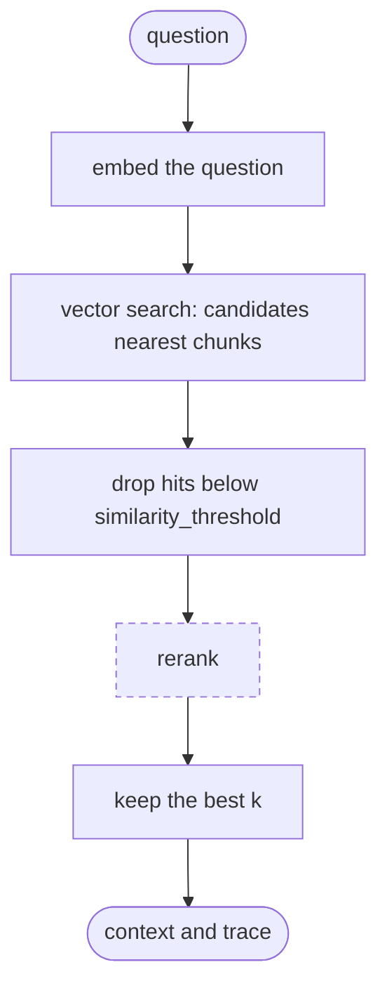
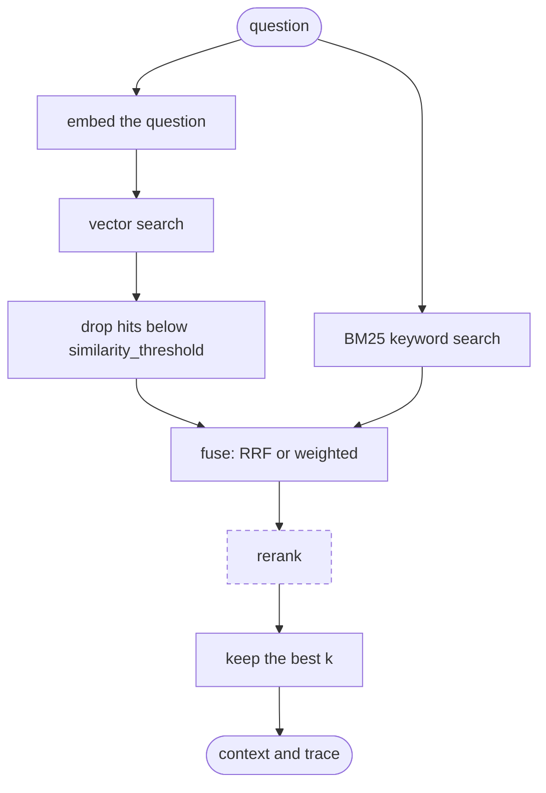
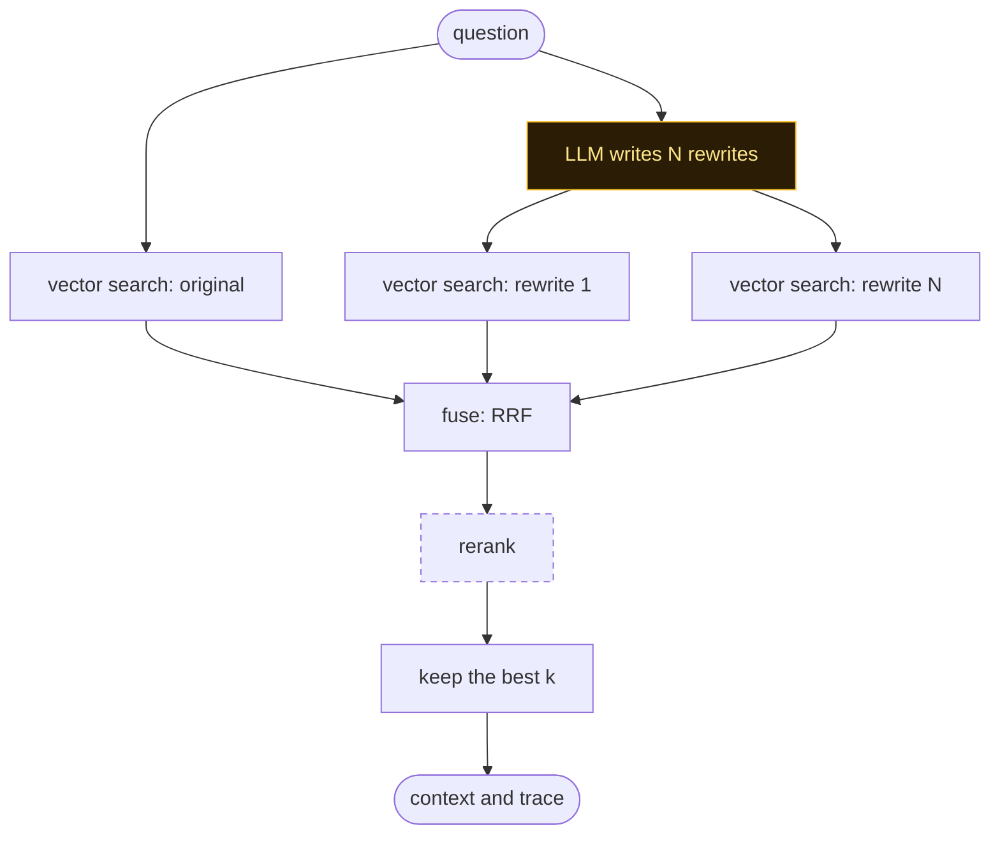
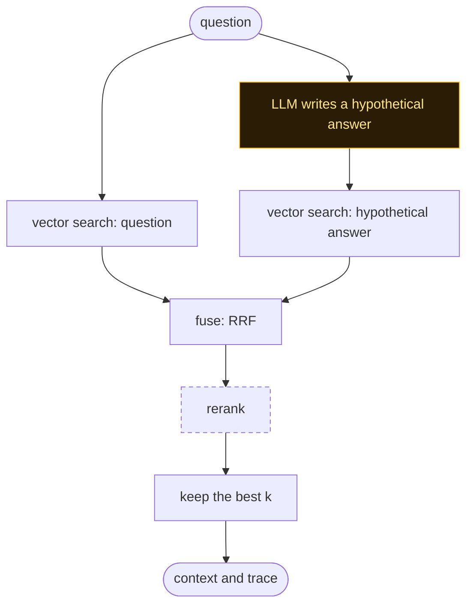
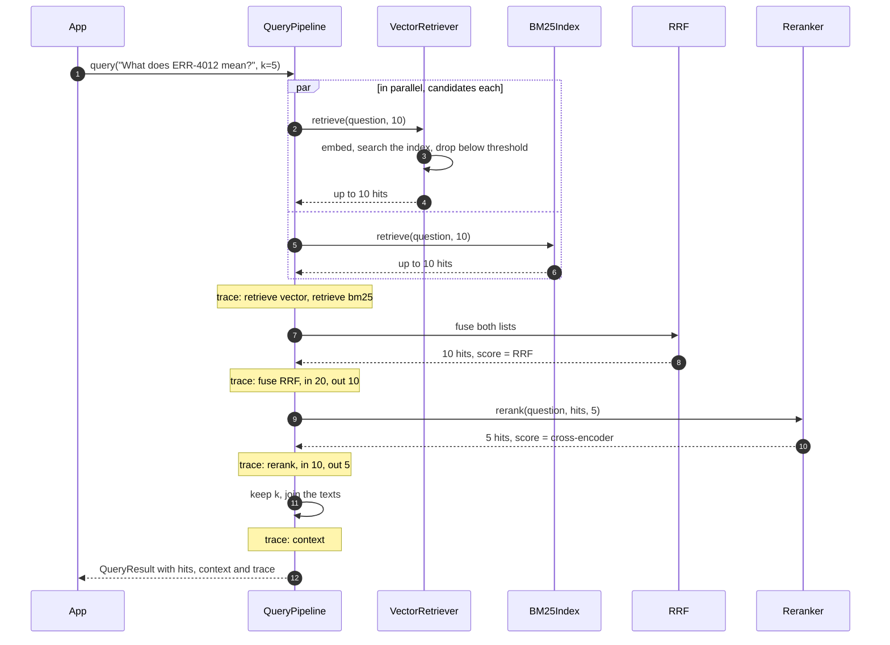

A pattern is a wiring of the same stages: which retrievers run, whether an LLM transforms the
question first, and how the lists are fused. Ingestion is identical for all four, and so is
everything after fusion: optional reranking, the first `k` hits, the context.

All four are plain functions in `astromesh_rag.patterns` that return a `QueryPipeline`, and
each one is also a value of `retrieval.pattern` in YAML. In the diagrams, dashed boxes are
optional and amber boxes call the LLM.

| Your questions… | Start with |
|---|---|
| use the same words as the documents | `naive` |
| contain codes, SKUs, product names, version numbers | `hybrid` |
| are worded nothing like the documents (colloquial vs formal) | `multi_query` |
| are short, and the documents are long explanatory passages | `hyde` |
| hit several near-identical documents (versions, siblings) | any of them, plus a reranker |

These are the hypotheses the [benchmark](/astromesh/rag/benchmark/) tests on a corpus built
with exactly those traps; check its results before you treat them as rules.

Options every pattern takes:

| Argument | YAML | Effect |
|---|---|---|
| `reranker=` | `reranking.enabled` + `provider` | Rescores the fused candidates |
| `rerank_k=` | `reranking.top_k` | How many the reranker keeps |
| `min_score=` | `retrieval.similarity_threshold` | Drops vector hits below this cosine |
| `candidates=` | `retrieval.candidates` | Hits fetched per retriever and per query (default `k * 2`) |

The snippets below assume this setup (swap `HashEmbedder` for a real embedder and `FakeLLM`
for a real model outside tests):

```python
from astromesh_rag import Document
from astromesh_rag.indexes import MemoryIndex
from astromesh_rag.patterns import hybrid, hyde, multi_query, naive
from astromesh_rag.pipeline import IngestPipeline
from astromesh_rag.retrievers import BM25Index
from astromesh_rag.splitters import RecursiveSplitter
from astromesh_rag.testing import FakeLLM, HashEmbedder

embedder, index, bm25 = HashEmbedder(), MemoryIndex(), BM25Index()
llm = FakeLLM(
    default="how do I get my money back\nrefund window for annual plans"
)
doc = Document("Refunds are accepted within 30 days of purchase.", id="pol-refunds")
await IngestPipeline(RecursiveSplitter(), embedder, index, bm25).ingest([doc])
```

## naive

Embed the question, return the chunks whose embeddings are closest. One model call, no moving
parts, and the baseline every other pattern must beat.



```yaml
retrieval: { pattern: naive, top_k: 5, similarity_threshold: 0.3 }
```

```python
result = await naive(embedder, index, min_score=0.3).query("refund window?", k=5)
```

**Fails when** the deciding token is rare or exact: embeddings place `ERR-4012` and
`ERR-4013` almost on top of each other, and a question that never uses the documents'
vocabulary lands far from the right chunk. A threshold set too high returns nothing; look for
`retrieve vector … out: 0` in the trace.

**Cost.** One embedding and one vector search per query.

## hybrid

Run a keyword search (BM25) next to the vector search and fuse the two rankings with
reciprocal rank fusion (RRF). Vectors catch meaning, BM25 catches exact tokens. The tokenizer
lowercases, strips accents and keeps hyphenated codes whole as well as in parts, so
`ERR-4012` matches `err-4012`, `err` and `4012`.



```yaml
retrieval:
  pattern: hybrid
  top_k: 5
  hybrid: { fusion: weighted, weights: [0.3, 0.7] }  # or { fusion: rrf }, the default
  bm25_path: ./docs.bm25.json                         # with a persistent vector store
```

```python
from astromesh_rag.fusion import WeightedFusion

result = await hybrid(embedder, index, bm25).query("ERR-4012", k=5)
weighted = hybrid(embedder, index, bm25, fusion=WeightedFusion([0.3, 0.7]))
```

If one retriever fails, its error goes in the trace and the other's hits are used; only both
failing raises `StageError`.

**Fails when** the BM25 index is missing documents the vector store has. It lives in memory:
build it in the same ingestion (the `IngestPipeline` with a keyword index does) and persist it
with `bm25_path`, or after a restart only the vector side answers. BM25 also rewards noise that
repeats your keywords, such as a release note that mentions `ERR-4012` without explaining it;
a reranker is the usual fix.

**Cost.** One embedding, one vector search and one BM25 scan (every chunk, in memory) per
query, in parallel; fusion is negligible.

## multi_query

Ask an LLM for N rewrites of the question (3 by default), search the original and every
rewrite, and fuse with RRF. Chunks that several wordings find rise to the top, and a rewrite
can use the documents' vocabulary when the user did not.



```yaml
retrieval: { pattern: multi_query, variants: 3, top_k: 5 }
```

```python
result = await multi_query(embedder, index, llm, variants=2).query("money back?", k=5)
```

From YAML, pass the model when building: `build(spec, llm=OpenAICompatLLM(base_url, api_key,
model))`. The rewrites come back one per line; numbering and bullets are stripped, the original
question is kept and duplicates of it dropped. The prompt is
`astromesh_rag.patterns.MULTI_QUERY_PROMPT`; to change it, write your own transform
([Extending](/astromesh/rag/extending/#a-custom-query-transform)).

**Fails when** the LLM call fails: that raises `StageError("transform", ...)` and the query
fails, so put retries or a fallback in your `LLM`. Rewrites can also drift away from the
question and pull in neighbors; the original query is always searched, which limits the damage.

**Cost.** One LLM call, then 1 + N embeddings and vector searches per query. The LLM round trip
dominates latency.

## hyde

Hypothetical Document Embeddings: an LLM writes the passage that *would* answer the question,
and that passage is searched next to the question itself. Documents look like passages, not
like questions, so the passage often lands closer to them.



```yaml
retrieval: { pattern: hyde, top_k: 5 }
```

```python
result = await hyde(embedder, index, llm).query("refund window?", k=5)
```

**Fails when** the model invents specifics: a made-up number or product name in the passage
pulls in the document that contains it, which is the wrong version on a corpus with superseded
policies. As with `multi_query`, a failing LLM call fails the query. The prompt is
`astromesh_rag.patterns.HYDE_PROMPT`.

**Cost.** One LLM call (longer output than `multi_query`'s rewrites), then 2 embeddings and 2
vector searches per query.

## Reranking

Not a pattern but a switch on all four: a cross-encoder reads the question and each candidate
together and scores them, which separates near-duplicates that embeddings blur.

```yaml
reranking: { enabled: true, provider: cross_encoder, top_k: 5 }
retrieval: { pattern: hybrid, top_k: 5, candidates: 20 }
```

```python
from astromesh_rag.rerankers import CrossEncoderReranker

rr = CrossEncoderReranker()  # needs the sentence-transformers extra
pipeline = hybrid(embedder, index, bm25, reranker=rr, rerank_k=5, candidates=20)
```

It costs one model pass over every candidate, so `candidates` is the knob: more candidates,
better recall for the reranker to work with, more latency. The reranker's scores replace
`score` (the earlier ones stay in `details`) and are not on a 0–1 scale, which is why
`similarity_threshold` is never applied to them. A failing reranker raises
`StageError("rerank", ...)`.

## One hybrid query, stage by stage

Every query returns a `QueryResult` with the hits, the context and a `trace`: one entry per
stage with its name, time in milliseconds, how many items went in and out, and the error if it
failed. The notes below mark where each trace entry is written.



Without a reranker, this is what the trace looks like — real output of `examples/hybrid.py`
in the repository, run offline with the test embedder (so only the shape is meaningful, not
the timings or the hits):

```text
> ¿Qué significa ERR-4012?
  trace:
    retrieve  vector                      1.0 ms  1->10
    retrieve  bm25                        0.2 ms  1->10
    fuse      RRF                         0.0 ms  20->10
    context   context                     0.0 ms  10->5
```

Each hit keeps every score it collected in `details` (`vector`, `bm25`, `rrf`, `rerank`) and
says who found it in `source` (`vector`, `bm25` or `bm25+vector`).
