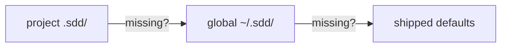

You never edit the shipped skills. Every phase skill starts by loading settings, and those
settings live in your project — or your home directory — so they survive updates:



The first one that has a file wins, and missing files are normal: with no `.sdd/` at all,
everything runs on the defaults below. `./install.sh --init` writes a commented `.sdd/` to
start from.

## `.sdd/config.yaml`

| Key | Default | Effect |
|---|---|---|
| `specs_dir` | `specs` | Where feature folders and `constitution.md` live |
| `language` | `en` | Language of every generated artifact |
| `ids.requirement` / `ids.task` | `REQ` / `T` | ID prefixes (`REQ-1`, `T-1`) |
| `gates` | `[specify, plan, tasks]` | Phases that stop for your approval. `[]` runs the cycle autonomously |
| `verify_command` | `""` | The command that counts as evidence. Empty: the constitution's test command, else the agent asks |
| `phases` | `[constitution, specify, plan, tasks, implement, verify]` | The order routing walks. Add your own phases here |

## Templates and rules

- **Templates.** Copy a shipped template (`spec.md`, `plan.md`, `tasks.md`, `verify.md`,
  `constitution.md`) to `.sdd/templates/` and edit it. Keep the `REQ-n` / `T-n` structure:
  the other phases read it.
- **Rules.** `.sdd/rules/all.md` adds rules to every phase; `.sdd/rules/<phase>.md` to one.
  They add to the skill and win where they conflict with it. Short, checkable bullets work
  best — for example, the example folder's `rules/specify.md` makes every spec carry a
  Security section, and the worked example in the repository has one because of it.

## Your own phases

Copy [`templates/my-phase`](https://github.com/monaccode/astromesh-sdd/tree/main/templates/my-phase)
to a folder named after your phase (say `sdd-adr`), say what it reads and the one file it
writes in the feature folder, install it next to the others, and add it to `phases:`:

```yaml
phases: [constitution, specify, adr, plan, tasks, implement, verify]
```

Routing walks `phases` in order and stops at the first phase that is not done, so an ADR
step between specify and plan runs before planning, and `sdd-plan` reads the ADR it left.

The [extending guide](https://github.com/monaccode/astromesh-sdd/blob/main/docs/extending.md)
has three complete recipes: a security section in every spec, artifacts in Spanish, and an
ADR phase.
