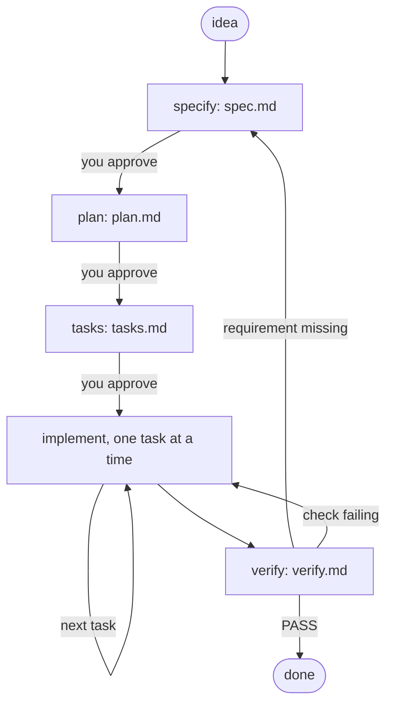

import { Aside } from '@astrojs/starlight/components';

**astromesh-sdd** packs Spec-Driven Development into seven skills for coding agents. The
work goes in a fixed order — a **spec** of what must be true, a **plan** of how, **tasks**
small enough to check, the code, and a **verification** against the spec — and every phase
writes a Markdown file next to your code. The next session, a teammate or a different agent
picks up exactly where the last one stopped, because the state of the feature is on disk
and not in a conversation.

The skills use the open [Agent Skills](https://agentskills.io) format (`SKILL.md`), so the
same folder works in Claude Code, Codex CLI, OpenCode, Kimi Code, Gemini CLI and GitHub
Copilot. Agents without skill support get the whole cycle from one `AGENTS.md` block.

```text
/plugin marketplace add monaccode/astromesh-sdd
/plugin install astromesh-sdd@astromesh
```

That is Claude Code; [Install](/astromesh/sdd/install/) covers every other agent.

## The cycle



| Skill | Writes | What it insists on |
|---|---|---|
| `sdd-constitution` *(optional)* | `constitution.md` | 5–9 project principles a reviewer can answer yes or no to, plus the real test command |
| `sdd-specify` | `spec.md` | Numbered requirements (`REQ-1`…) with Given/When/Then acceptance; unknowns marked `[NEEDS CLARIFICATION]`, never guessed |
| `sdd-plan` | `plan.md` | Decisions with the alternative rejected, a file map, risks, and every step citing the requirements it serves |
| `sdd-tasks` | `tasks.md` | Small ordered tasks (`T-1`…), each with a command that proves it done |
| `sdd-implement` | code, ticked tasks | One task at a time: failing test, minimum code, passing check, tick, commit |
| `sdd-verify` | `verify.md` | Runs the suite now and traces every requirement to tasks and evidence; PASS only when nothing is uncovered |

The seventh skill, `sdd`, looks at which files exist and tells the agent which phase is
next. Four rules hold in every phase:

- **Human gate.** After specify, plan and tasks the agent stops for approval, and records
  it in the file (`**Status:** approved`), so a fresh session knows too.
- **Traceability.** Every plan step and task cites a requirement. A requirement nobody cites
  will not be built; a task that cites nothing is scope creep. Verification fails both.
- **Spec first.** A requirement discovered mid-work goes into `spec.md` before it goes into
  code. IDs are permanent: never renumbered, never reused.
- **Evidence.** A task is done when its check ran in this session, not when the code looks
  right.

## What a feature looks like

The repository ships [`examples/specs/001-slugify-title`](https://github.com/monaccode/astromesh-sdd/tree/main/examples/specs/001-slugify-title),
produced by the skills in Claude Code from a one-line request — "add `slugify(title)`:
lowercase, ASCII only, hyphen-separated, at most 5 words" — to a verified feature:

```text
specs/001-slugify-title/
  spec.md      7 requirements, a Security section (from a project rule), non-goals
  plan.md      decisions, file map, 5 test-first steps, coverage table
  tasks.md     T-1 … T-3, each with its check, all ticked
  verify.md    suite output + traceability, verdict PASS
```

## What we learned building it

- **The spec asks better questions than the prompt.** Given a one-line request, `sdd-specify`
  came back with five real edge cases — characters with no ASCII form, whether `don't`
  splits, whether symbols count as words — instead of guessing. Each answer became a
  requirement with an example, and each example became a test.
- **Approval has to live in the file.** The first version kept "approved" in the chat. A
  fresh session then found a draft spec and went straight to planning. Now each gate writes
  `**Status:** approved` into the artifact, and routing sends a draft back to its gate.
- **One folder serves most agents.** Codex, OpenCode, Kimi Code, Gemini CLI and Copilot all
  read `.agents/skills/`, so the installer has two destinations, not seven. Every path is
  checked against the agent's own documentation and cited in the install guide.
- **An agent will plan around an open question if you let it.** Told "approve the spec as
  written" with two clarifications still open, OpenCode planned anyway and isolated the
  undecided behavior behind one seam. Reasonable, but it is why `sdd-plan` asks for open
  questions to be resolved first.

<Aside type="note">
Tested before release: the full cycle in Claude Code (verdict PASS), and specify plus plan
in OpenCode reading from `.agents/skills/`. Kimi Code, Codex CLI, Gemini CLI and GitHub
Copilot are installed to their documented paths but have not been run end to end yet.
</Aside>

## How it relates to the rest of Astromesh

SDD is not part of the runtime and depends on nothing in it. It is how you build the
software *around* agents — a Nexus feature, a Herald channel, an ADK project — with a
coding agent, in the same spec → plan → tasks → verify order the Astromesh repositories
themselves are built in.

## Status and license

Version 0.1.0. Licensed under Apache-2.0. Source:
[github.com/monaccode/astromesh-sdd](https://github.com/monaccode/astromesh-sdd).
Customizing the skills is covered in [Customizing](/astromesh/sdd/customizing/).
